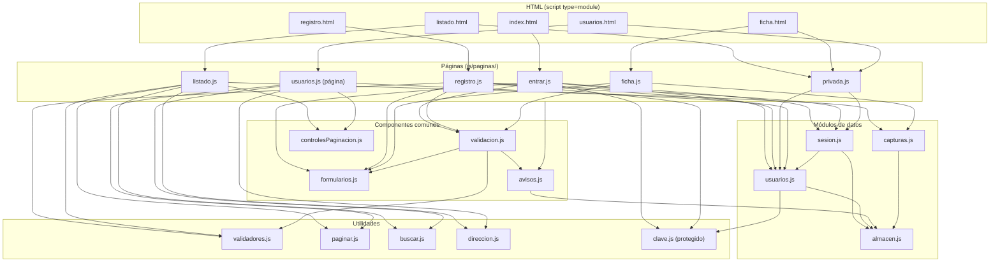

# Horizonte


## Mi proyecto

**Horizonte** es un diario personal de fotografía y observación de **paisajes, del cielo y del espacio**. Cada usuario guarda sus capturas (un atardecer, una tormenta, una aurora, la Vía Láctea, una nebulosa…) con su lugar, sus coordenadas, sus imágenes y la información de cómo las hizo. El administrador gestiona a los usuarios de la aplicación. Se inspira en Locationscout (paisajes con coordenadas) y AstroBin (astrofotografía).

**Web publicada:** <https://dwec-2dawt-2627-proyectodomeval-dgo.vercel.app>

### La entidad

La entidad es la **captura**. Cada usuario ve solo las suyas. Hay un **campo condicional** (los datos astronómicos, solo si la categoría es «Espacio») y un **grupo dinámico** (las imágenes, de 0 a 3).

| Campo | Control | Obligatorio | Regla de validación | Mensaje si no se cumple |
|-------|---------|:-----------:|---------------------|-------------------------|
| Título | Texto | Sí | No puede quedar vacío; como mucho 80 caracteres | «Escribe un título.» |
| Categoría | Botones de opción: Paisaje, Cielo, Espacio | Sí | Hay que elegir una | «Elige una categoría.» |
| Fecha y hora | `datetime-local` | Sí | No puede ser futura (el `max` lo pone el código con la fecha y la hora de ahora) | «Escribe la fecha y la hora.» / «La fecha no puede ser futura.» |
| Lugar | Texto | Sí | No puede quedar vacío; como mucho 80 caracteres | «Escribe el lugar.» |
| Coordenadas GPS | Texto | Sí | Regex del formato `36.7213, -4.4214` **y** comprobación con código de los rangos (latitud entre −90 y 90, longitud entre −180 y 180) | «Escribe las coordenadas.» / «Usa el formato 36.7213, -4.4214.» / «La latitud va de −90 a 90 y la longitud de −180 a 180.» |
| Altitud (m) | Número | Sí | Entre −430 y 8849 | «Escribe la altitud.» / «La altitud va de −430 a 8849 m.» |
| Condiciones del cielo | Lista desplegable: despejado, nubes, niebla, lluvia, tormenta, nieve, aurora | Sí | Hay que elegir una | «Elige las condiciones del cielo.» |
| Equipo | Lista desplegable: móvil, cámara, prismáticos, telescopio | Sí | Hay que elegir uno | «Elige el equipo.» |
| Código de observatorio | Texto | No | Si se rellena: regex `OBS-NNNN-D` **y** comprobación con código de que el último dígito (D) es el dígito de control: la suma de las cuatro cifras multiplicadas por 3, 1, 3 y 1, módulo 10 (`OBS-4821-7`: 4·3 + 8·1 + 2·3 + 1·1 = 27 → 7) | «Usa el formato OBS-4821-7.» / «El dígito de control no es correcto.» |
| **Campo condicional** (solo si la categoría es «Espacio»; con `hidden` y `disabled` en otro caso) | | | | |
| Código de catálogo | Texto | Sí, si se ve | Regex: `M42`, `NGC 1976`, `IC 434` | «Escribe el código de catálogo.» / «Usa un código como M42, NGC 1976 o IC 434.» |
| Ascensión recta | Texto | Sí, si se ve | Regex del formato `05h 35m 17s` | «Escribe la ascensión recta.» / «Usa el formato 05h 35m 17s.» |
| Declinación | Texto | Sí, si se ve | Regex del formato `-05° 23′ 28″` (también con `'` y `"` del teclado) | «Escribe la declinación.» / «Usa el formato -05° 23′ 28″.» |
| **Grupo dinámico: imágenes** (de 0 a 3, desde un `<template>`) | | | | |
| URL de la imagen | Texto | Sí, en cada imagen añadida | Regex de URL `http://` o `https://` (se guarda la URL, no el fichero, porque `localStorage` solo admite unos 5 MB) | «Escribe la dirección de la imagen.» / «Escribe una URL que empiece por http:// o https://.» |
| Pie de foto | Texto | No | Como mucho 120 caracteres | «Usa 120 caracteres como mucho.» |

### El registro de usuarios

| Campo | Control | Regla | Mensaje |
|-------|---------|-------|---------|
| Nombre de usuario | Texto | Obligatorio; regex: de 3 a 20 caracteres entre letras, cifras y `_`; y no puede estar ocupado | «Escribe un nombre de usuario.» / «Usa de 3 a 20 letras, cifras o _.» / «Ese nombre ya está en uso.» |
| Correo | Correo (`type="email"`) | Obligatorio; regex de correo | «Escribe tu correo.» / «Escribe un correo válido.» |
| Contraseña | Contraseña | Obligatoria; mínimo 8 caracteres, con una minúscula (`\p{Ll}`), una mayúscula (`\p{Lu}`) y una cifra. Se ve cuáles cumple mientras se escribe | «Escribe una contraseña.» / «La contraseña no cumple todos los requisitos.» |
| Repetir contraseña | Contraseña | Obligatoria e igual que la contraseña | «Repite la contraseña.» / «Las contraseñas no coinciden.» |
| Aceptación | Casilla | Obligatoria | «Tienes que aceptar las condiciones.» |

### Páginas

| Página | Acceso | Qué hace |
|--------|--------|----------|
| `index.html` | Pública | Inicio de sesión. Si ya hay sesión, lleva al listado |
| `registro.html` | Pública | Alta de un usuario. El primero que se registra es administrador |
| `listado.html` | Usuarios | Lista, busca, pagina y borra las capturas del usuario |
| `ficha.html` | Usuarios | Da de alta una captura o edita una existente (`ficha.html?id=…`) |
| `usuarios.html` | Administradores | Lista y busca usuarios, y da o quita el rol de administrador |

## Arquitectura y módulos

La aplicación son **13 módulos comunes** en `js/` y **6 módulos de página** en `js/paginas/`, todos
módulos de JavaScript (`import` y `export`), sin librerías. Cada HTML carga un solo
`<script type="module">` que llama a la función `iniciarX` de su página y le pasa lo que necesita.

### Diagrama de módulos

Una flecha `A --> B` significa que `A` hace `import` de `B`. Salen de los `import` reales de cada
archivo (los listé con `grep` en `js/` y `js/paginas/`). El diagrama se lee de arriba abajo: del HTML
a las utilidades, y nunca hacia arriba (ningún módulo importa a una página).



(El diagrama se dibuja en GitHub. En la documentación de `docs/`, que toma este README como
portada, se ve como un bloque de código, porque JSDoc no dibuja Mermaid.)

**Qué he simplificado.** Solo una cosa: las seis páginas importan `avisos.js`, y en lugar de dibujar
seis flechas hay una sola desde el grupo «Páginas» (`PAGINAS --> avisos`). El resto de flechas
están todas. Los módulos sin flechas de salida (`almacen.js`, `validadores.js`, `paginar.js`,
`buscar.js`, `direccion.js`, `controlesPaginacion.js`, `formularios.js` y `clave.js`) no importan
nada. Hay un detalle que se ve en el diagrama: `sesion.js` importa `usuarios.js` solo para usar
`ROLES`.

### Tabla de módulos

«Usa el DOM» dice si el módulo toca el documento y **cómo lo recibe**: ninguno lo coge de
`document`, `localStorage` o `location`; en `js/` no hay un solo uso de esos nombres fuera de los
comentarios. Lo reciben como parámetro.

| Módulo | Qué hace | Usa el DOM | Exporta |
|--------|----------|------------|---------|
| `js/almacen.js` | Lee y escribe JSON en un almacenamiento sin que nunca falle: si no hay nada, está estropeado o tiene otra forma, devuelve el valor por defecto | No. Recibe el almacenamiento como primer parámetro | `leerJSON`, `guardarJSON`, `borrar` |
| `js/usuarios.js` | Usuarios en `localStorage`: registrar (el primero es administrador), comprobar credenciales, cambiar el rol y comparar nombres | No. Recibe el almacenamiento y la función de resumen (`resumir`) | `CLAVE_USUARIOS`, `ROLES`, `TEXTOS_ROL`, `mismoNombre`, `listarUsuarios`, `nombreOcupado`, `registrarUsuario`, `cambiarRol`, `comprobarCredenciales` |
| `js/sesion.js` | La sesión en `sessionStorage` (solo nombre y rol) | No. Recibe el almacenamiento | `CLAVE_SESION`, `iniciarSesion`, `leerSesion`, `cerrarSesion`, `esAdministrador` |
| `js/capturas.js` | Capturas de cada usuario (una clave por usuario): listar, buscar, crear, actualizar y borrar, con `id` único | No. Recibe el almacenamiento, el usuario y, si se quiere, `crearId` | `PREFIJO_CAPTURAS`, `claveCapturas`, `listarCapturas`, `buscarCaptura`, `crearCaptura`, `actualizarCaptura`, `borrarCaptura` |
| `js/clave.js` (protegido, no se modifica) | Resumen SHA-256 de la contraseña con `crypto.subtle` | No | `resumirClave` |
| `js/validadores.js` | Validadores de formato: reciben el valor y devuelven el mensaje de error o `''`; el objeto `validadores` los reúne por el nombre de `data-validar` | No (funciones puras) | `LONGITUD_MINIMA_CLAVE`, `LATITUD_MAXIMA`, `LONGITUD_MAXIMA`, `validarNombreUsuario`, `validarCorreo`, `requisitosClave`, `validarClave`, `validarRepetirClave`, `validarGps`, `validarUrlImagen`, `validarCatalogo`, `validarAscensionRecta`, `validarDeclinacion`, `digitoControlObservatorio`, `validarObservatorio`, `validadores` |
| `js/validacion.js` | Validación en tiempo real de un formulario (cuándo se valida, de dónde sale el mensaje) | Sí. Recibe el `formulario` | `mensajeDeError`, `activarValidacion` |
| `js/formularios.js` | Mostrar el estado de un campo y poner el formulario «enviando» | Sí. Recibe el campo, su caja, el formulario y el botón | `mostrarEstadoCampo`, `ponerEnviando` |
| `js/avisos.js` | Sistema de avisos: evento propio `aviso`, único oyente, aviso pendiente entre páginas | Sí. Recibe el `documento` y la región (`escucharAvisos`), el elemento desde el que se lanza (`lanzarAviso`) y el almacenamiento para el aviso pendiente | `EVENTO_AVISO`, `CLAVE_AVISO_PENDIENTE`, `TIPOS_AVISO`, `lanzarAviso`, `escucharAvisos`, `guardarAvisoPendiente`, `mostrarAvisoPendiente` |
| `js/paginar.js` | Trocea una lista en páginas (función pura) | No | `paginar` |
| `js/buscar.js` | Texto sin tildes y en minúsculas para buscar, y la pausa del buscador (_debounce_) | No | `normalizar`, `retardar` |
| `js/direccion.js` | Lee y escribe `?pagina=` en la dirección | No. Recibe el texto de la dirección y la función que la cambia | `leerPagina`, `escribirPagina` |
| `js/controlesPaginacion.js` | Pinta «Anterior», los números y «Siguiente», y escucha sus clics | Sí. Recibe el `documento` y el `contenedor` | `pintarControles`, `escucharControles` |
| `js/paginas/privada.js` | Protege las páginas privadas y prepara la cabecera común | Sí. Recibe `documento`, `almacenSesion`, `reemplazar` y `soloAdministradores` (`true` en `usuarios.html`) | `PAGINA_DE_ENTRADA`, `PAGINA_SIN_PERMISO`, `iniciarPaginaPrivada` |
| `js/paginas/entrar.js` | Inicio de sesión (`index.html`) | Sí. Recibe `documento`, `almacenUsuarios`, `almacenSesion`, `navegar` y `resumir` | `PAGINA_TRAS_ENTRAR`, `MENSAJE_CREDENCIALES`, `iniciarEntrar` |
| `js/paginas/registro.js` | Registro (`registro.html`) | Sí. Recibe lo mismo que `entrar.js` | `PAGINA_TRAS_REGISTRO`, `iniciarRegistro` |
| `js/paginas/listado.js` | Listado de capturas, buscador, paginación y borrado (`listado.html`) | Sí. Recibe `documento`, `sesion`, `almacenCapturas`, `busqueda`, `actualizarDireccion`, `porPagina` y `esperaBusqueda` | `TEXTOS`, `fechaLegible`, `ordenarPorFecha`, `textoBuscable`, `iniciarListado` |
| `js/paginas/ficha.js` | Alta y edición de una captura (`ficha.html`) | Sí. Recibe `documento`, `sesion`, `almacenCapturas`, `almacenSesion`, `busqueda`, `navegar`, `reemplazar` y `ahora` | `CATEGORIA_ESPACIO`, `MIN_IMAGENES`, `MAX_IMAGENES`, `PAGINA_LISTADO`, `MENSAJE_NO_EXISTE`, `fechaLocal`, `datosDeCaptura`, `iniciarFicha` |
| `js/paginas/usuarios.js` | Administración de usuarios (`usuarios.html`) | Sí. Recibe `documento`, `sesion`, `almacenUsuarios`, `busqueda`, `actualizarDireccion`, `porPagina` y `esperaBusqueda` | `ordenarPorNombre`, `textoBuscable`, `iniciarUsuarios` y, reexportado de `js/usuarios.js`, `TEXTOS_ROL` |

Las páginas HTML (`index.html`, `registro.html`, `listado.html`, `ficha.html` y `usuarios.html`) no
son módulos, pero son el único sitio donde aparecen `localStorage`, `sessionStorage`, `location` y
`history` de verdad: ahí se «conectan» los módulos con el navegador.

### Cómo están hechos mis objetos

**No hay clases.** No hay ninguna palabra clave `class` en `js/`. Todo son **funciones** y, cuando
una función tiene que devolver varias cosas, devuelve un **objeto con funciones**. No he necesitado
clases porque no hay objetos con estado que se creen muchas veces: el estado vive en los
almacenamientos y las funciones lo reciben cada vez. Lo que sí hay son **cierres** (funciones que
recuerdan las variables de la función que las creó):

- **`activarValidacion`** (`js/validacion.js`) es una **función fábrica**: devuelve
  `{ validarCampo, validarFormulario }`. Ese objeto **es** mi objeto con métodos (el enunciado pide
  objetos con métodos): `validarCampo` y `validarFormulario` son sus métodos. Recuerdan el
  `formulario`, las `reglas` y el `WeakSet` `tocados`, que nadie más puede tocar: es lo más parecido
  a un objeto con atributos privados, sin `class`.
- **`retardar`** (`js/buscar.js`) devuelve una función nueva que recuerda su `temporizador`. Cada
  llamada a `retardar` tiene el suyo, así que el buscador del listado y el de usuarios no se pisan.
- **`escucharAvisos`** (`js/avisos.js`) devuelve una **función de limpieza** que quita los dos
  oyentes con `removeEventListener`. Los tests la usan para no dejar oyentes de un test a otro.
- **`iniciarListado`** e **`iniciarUsuarios`** definen dentro `crearElemento` y `pintar`, que
  comparten las variables de la página (la lista, el campo de búsqueda…) sin tener que pasarlas una
  y otra vez. `iniciarFicha` hace lo mismo con sus funciones internas.

#### Patrones de diseño

- **Observador (publicador/suscriptor): el evento `aviso`** (`js/avisos.js`). Quien quiere avisar
  llama a `lanzarAviso(elemento, mensaje, tipo)`, que lanza un `CustomEvent` con `bubbles: true` y
  `detail: { mensaje, tipo }`. Un **único** oyente en `document`, puesto por `escucharAvisos` desde
  `iniciarPaginaPrivada`, `iniciarEntrar` e `iniciarRegistro`, lo recoge y lo pinta. **Por qué:**
  quien avisa (`validacion.js`, el listado, la ficha…) no sabe cómo ni dónde se muestran los avisos,
  y la región de avisos no sabe quién avisa. Para cambiar el aspecto de los avisos solo toco
  `avisos.js`.
- **Inyección de dependencias** (todas las páginas y los módulos de datos). Lo que cambia entre el
  navegador y los tests se **recibe como parámetro** en vez de coger un valor global:
  - el almacenamiento (`almacen`, `almacenUsuarios`, `almacenSesion`, `almacenCapturas`);
  - la navegación (`navegar`, `reemplazar`) y la dirección (`busqueda`, `actualizarDireccion`);
  - el resumen de la contraseña (`resumir`, por defecto `resumirClave`), la hora (`ahora`, por
    defecto `() => new Date()`) y el generador de `id` (`crearId` en `crearCaptura`, por defecto
    `crypto.randomUUID()`).

  **Por qué:** los tests pasan un `AlmacenFalso`, un `vi.fn()` o una hora fija y el código funciona
  igual. Se explica con un ejemplo en la sección siguiente.
- **Módulo** (ES modules, en todos los archivos). Cada archivo expone solo lo que lleva `export` y
  esconde el resto: por ejemplo, `crearAviso` en `avisos.js`, `crearControl` en
  `controlesPaginacion.js` o `tieneLaFormaEsperada` en `almacen.js` no se exportan. **Por qué:**
  cada módulo tiene una responsabilidad, se importa solo lo que hace falta (el diagrama de arriba) y
  no hay variables globales.
- **Delegación de eventos** (no está en el libro clásico de patrones, pero es una técnica fija
  en mi código). Un solo oyente en el contenedor atiende a todos sus hijos con
  `evento.target.closest(…)`: `escucharControles` (`controlesPaginacion.js`), la lista del listado
  (`[data-accion="borrar"]`), la lista de usuarios (`[data-accion="cambiar-rol"]`), el grupo de
  imágenes de la ficha (`[data-accion]`) y el botón «Cerrar» de los avisos. **Por qué:** los
  elementos se vuelven a crear al pintar o al añadir una imagen, y un oyente por botón se perdería
  o se apilaría. El detalle está en [Eventos](#eventos).
- **Decorador de funciones (_debounce_): `retardar`** (`js/buscar.js`). Un decorador envuelve una
  función y le añade un comportamiento sin cambiarla. `retardar` recibe una función y devuelve
  otra que hace lo mismo pero esperando `ms` milisegundos sin nuevas llamadas. La usan
  `iniciarListado` y `iniciarUsuarios` para que el buscador no filtre en cada tecla. **Por qué:**
  `input` salta con cada tecla y no quiero repintar la lista 10 veces para escribir una palabra.
- **Elementos desde `<template>`** (`listado.js`, `usuarios.js` y `ficha.js`). Es una técnica de la
  plataforma web, no el patrón «Template Method» de la programación orientada a objetos, así que no
  la cuento entre los patrones. El HTML trae el molde (`#plantilla-captura`, `#plantilla-usuario`, `#plantilla-imagen`) y el código lo copia con
  `plantilla.content.firstElementChild.cloneNode(true)` y lo rellena con `textContent`. **Por qué:**
  el enunciado no permite `innerHTML` con datos, y así la estructura está en el HTML y no en
  cadenas de texto del JavaScript.

### Cómo reciben las páginas lo que necesitan

Cada página tiene su función `iniciarX({ … })` con **un objeto de dependencias**. El HTML es quien
las conecta con el navegador real. Esto es el `<script type="module">` de `listado.html`:

```html
<script type="module">
  import { iniciarPaginaPrivada } from './js/paginas/privada.js';
  import { iniciarListado } from './js/paginas/listado.js';

  const sesion = iniciarPaginaPrivada({
    documento: document,
    almacenSesion: sessionStorage,
    reemplazar: (url) => location.replace(url),
  });
  if (sesion !== null) {
    iniciarListado({
      documento: document,
      sesion,
      almacenCapturas: localStorage,
      busqueda: location.search,
      actualizarDireccion: (url) => history.replaceState(null, '', url),
    });
  }
</script>
```

Y esta es la firma de `iniciarListado` en `js/paginas/listado.js`, con los valores por defecto de lo
que solo cambian los tests:

```js
export function iniciarListado({
  documento,
  sesion,
  almacenCapturas,
  busqueda = '',
  actualizarDireccion = () => {},
  porPagina = POR_PAGINA,
  esperaBusqueda = ESPERA_BUSQUEDA,
}) { … }
```

Fíjate en que `iniciarListado` no nombra `localStorage`, `location` ni `history`: usa
`almacenCapturas`, `busqueda` y `actualizarDireccion`. Las demás páginas hacen lo mismo con su
propia lista de dependencias (la tabla de arriba): `navegar` (`location.assign`) y `reemplazar`
(`location.replace`) para cambiar de página, `resumir` para la contraseña y `ahora` para la fecha de
la ficha.

**La regla para los módulos de datos:** `almacen.js`, `usuarios.js`, `sesion.js` y `capturas.js`
reciben **el almacenamiento como primer parámetro** (`listarCapturas(almacen, usuario)`,
`registrarUsuario(almacen, { … }, resumir)`, `leerSesion(almacen)`…). `avisos.js` hace lo mismo en
`guardarAvisoPendiente` y `mostrarAvisoPendiente`.

**Por qué así se puede probar:**

- Los tests de integración (`tests/integracion/`) llaman a `iniciarListado` con un documento de
  happy-dom, un `AlmacenFalso` (`tests/AlmacenFalso.js`) en lugar de `localStorage`, y `vi.fn()` en
  lugar de `navegar` o `actualizarDireccion`. Después comprueban qué se pintó y a qué dirección se
  intentó ir (por ejemplo,
  `expect(actualizarDireccion).toHaveBeenLastCalledWith('listado.html?pagina=2')`), sin navegador
  real.
- Con una dependencia por defecto que se puede sustituir (`ahora`, `resumir`, `crearId`) el test
  controla lo que no se puede controlar: la hora de hoy, el cálculo asíncrono de un SHA-256 o un
  `id` aleatorio.
- Si una página usara `localStorage` o `location` directamente, el test no podría sustituirlos y
  tendría que tocar los del navegador. Así, cada test crea su propio almacenamiento falso.

### Qué documenta el JSDoc y cómo se genera

Cada archivo de `js/` y `js/paginas/` empieza con un comentario `/** … */` con `@module` y tiene
JSDoc en sus funciones y constantes exportadas. Además, el comentario de cada módulo de página
documenta **el HTML que necesita** en un bloque «HTML que necesita:» (por ejemplo, al principio de
`js/paginas/listado.js`: los `id` y las plantillas que la página tiene que traer). Las etiquetas que
uso (las busqué con `grep`):

| Etiqueta | Para qué |
|----------|----------|
| `@module` | Nombre del módulo (`avisos`, `paginas/privada`…): cada archivo es una página de la documentación |
| `@param` y `@returns` | Cada parámetro (con su tipo y para qué sirve) y lo que devuelve la función |
| `@typedef` y `@property` | Tipos de objetos: `DetalleAviso`, `Sesion`, `Captura`, `Usuario`, `Validacion`, `Pagina`… |
| `@example` | Un ejemplo de uso en las funciones puras y en la mayoría de las demás; las que tocan el DOM o el almacenamiento llevan siempre `@param` y `@returns` y a veces no llevan `@example` |
| `@throws` | Los errores que lanza una función: `RangeError` en `paginar` y `cambiarRol`; `Error` en `capturas.js` y `registrarUsuario` (nombre ocupado o no se puede guardar); `Error` en `validacion.js` (`cajaDeError` sin caja de error y `mensajeDeError` con un `data-validar` desconocido) |
| `@listens` y `@fires` | Los eventos que escucha o lanza una función (`click`, `input`, `blur`, `change`, `submit`, `close`, `aviso`) |
| `@template` | Un tipo genérico: `leerJSON` devuelve el mismo tipo que su valor por defecto |
| `@type` | El tipo de una constante: el objeto `validadores` |
| `{@link …}` | Enlaces entre funciones y tipos dentro de los textos |

**Los tipos de función se escriben `function(string): void`**, no `(x: string) => void`: esta
última es sintaxis de TypeScript y hace fallar `npm run docs`. Por ejemplo,
`@param {function(string): void} dependencias.reemplazar`.

**Cómo se genera.** `npm run docs` ejecuta `jsdoc -c jsdoc.json`. Ese archivo de configuración dice:

- `source`: incluye la carpeta `js`, y solo los archivos que acaban en `.js` (`includePattern`);
- `opts.recurse`: entra en las subcarpetas (así entra `js/paginas/`);
- `opts.destination`: escribe el resultado en **`docs/`**;
- `opts.readme`: usa este `README.md` como portada;
- `plugins/markdown`: permite escribir Markdown dentro de los comentarios (negritas, listas…).

El resultado queda en `docs/` (abre `docs/index.html` en el navegador). `docs/` **está en el
`.gitignore`** (y en `.prettierignore`): no se sube al repositorio, se vuelve a generar con
`npm run docs`. Solo se documenta `js/`: los HTML, los tests y los scripts no entran.

## Cómo ejecutarlo

### Abrir el proyecto

El proyecto trae su **Dev Container** en `.devcontainer/`: un entorno con Node.js 24 y Chromium (para
las pruebas de extremo a extremo), igual en cualquier ordenador.

1. Con **Docker Desktop** en marcha, abre en VS Code la carpeta del repositorio (la que contiene
   `.devcontainer/`).
2. Ejecuta **Dev Containers: Reopen in Container**. La primera vez tarda, porque construye la imagen.
3. Al crearse, el contenedor ejecuta `npm install`; al abrirse, arranca el servidor de la web.
4. Abre **<http://localhost:3901>** (si no responde, búscala en el panel **Puertos** de VS Code).

La web usa módulos de JavaScript, así que necesita un servidor: abrir los HTML con doble clic no
funciona. Las órdenes de abajo se escriben en la terminal de VS Code, que ya es la del contenedor.

### Órdenes

| Orden | Qué hace |
|-------|----------|
| `npm test` | Pasa los tests unitarios (`tests/unitarios/`) y de integración (`tests/integracion/`) con Vitest. |
| `npm run coverage` | Pasa los mismos tests y mide la cobertura; el informe queda en `coverage/`. |
| `npm run e2e` | Pasa las pruebas de extremo a extremo de `e2e/` con Playwright, en Chromium. Arranca la web solo; con la variable `BASE_URL` las pasa contra otra dirección (por ejemplo, la web publicada). |
| `npm run lint` | Revisa el JavaScript con ESLint y sus reglas (explicadas en «ESLint y Prettier»). |
| `npm run format:check` | Comprueba que todo el código tiene el formato de Prettier, sin cambiar nada. |
| `npm run format` | Le da el formato de Prettier a todo el código. |
| `npm run docs` | Genera la documentación del código a partir de los comentarios JSDoc, en `docs/`. |
| `npm run build` | Prepara la web publicable en `dist/`: las páginas, `css/`, `js/`, `img/` y el CSS de Bootstrap. |

`coverage/`, `docs/`, `dist/`, `playwright-report/` y `test-results/` se generan al ejecutar estas
órdenes y no se suben al repositorio (ver el `.gitignore`).

### Al terminar

Cierra VS Code y borra el contenedor para liberar memoria (tu trabajo está en la carpeta, no se
pierde). En una terminal de Windows (PowerShell):

```bash
docker rm -f $(docker ps -aq --filter label=devcontainer.local_folder)
```

## Almacenamiento y sesión

Horizonte no tiene servidor: todo se guarda en el navegador, siempre como texto JSON y siempre a
través de `js/almacen.js`, cuyas lecturas nunca fallan (si lo guardado está estropeado, devuelven un
valor por defecto).

### Las claves

| Clave | Dónde | Qué guarda | Ejemplo |
|-------|-------|------------|---------|
| `horizonte.usuarios` | `localStorage` | La lista de usuarios: nombre, correo, **resumen** SHA-256 de la contraseña (nunca la contraseña) y rol. | `[{"nombre":"ana","correo":"ana@ejemplo.es","resumen":"4f7e57cc…47e5","rol":"administrador"}]` |
| `horizonte.sesion` | `sessionStorage` | Quién ha entrado y con qué rol. Nada más: ni correo ni contraseña. | `{"nombre":"ana","rol":"administrador"}` |
| `horizonte.aviso` | `sessionStorage` | Un aviso que espera a la página siguiente («Te has registrado»). Se borra al mostrarse. | `{"mensaje":"Te has registrado…","tipo":"exito"}` |
| `horizonte.capturas.<usuario>` | `localStorage` | Las capturas de **un** usuario, cada una con su `id` único (`crypto.randomUUID()`). Hay una clave por usuario, con el nombre en minúsculas. | `horizonte.capturas.ana` → `[{"titulo":"Vía Láctea en el Teide","categoria":"espacio",…,"id":"3b241101-…"}]` |

**Una clave por usuario** (`js/capturas.js`): cada uno lee solo la suya, así que no puede ver ni
cambiar las capturas de otro, ni aunque conozca su `id`. Si lo guardado está estropeado, se
descartan las entradas que no son capturas (sin `id` de texto) y se quedan las buenas.

### Por qué cada dato va donde va

- **`localStorage` dura para siempre** (hasta que se borra). Los usuarios tienen que seguir ahí
  mañana, así que van en `localStorage`. Las capturas, igual.
- **`sessionStorage` dura lo que dura la pestaña.** La sesión tiene que acabarse al cerrarla: si
  vuelves a abrir la web, tienes que entrar otra vez. El aviso pendiente solo tiene sentido al pasar
  de una página a la siguiente, así que también va aquí.

### El rol y la protección de las páginas

- **El rol se decide al registrarse:** el primer usuario de la lista es `administrador` y los demás,
  `usuario` (`js/usuarios.js`). Al entrar, el rol se copia a la sesión.
- **Por sesión:** cada página privada (listado, ficha y usuarios) llama al empezar a
  `iniciarPaginaPrivada` (`js/paginas/privada.js`). Si no hay sesión, o está estropeada, lleva a
  `index.html` con `location.replace`, que sustituye la página en el historial: el botón «Atrás» no
  devuelve a la página privada.
- **Por rol:** `usuarios.html` se inicia con `soloAdministradores: true`. Si la sesión no es de un
  administrador, la página lleva al listado y deja el aviso «La página de usuarios es solo para
  administradores.». Además, el enlace «Usuarios» del menú solo se muestra a los administradores.
- **Al revés:** si ya hay sesión, `index.html` lleva directamente al listado.

### Por qué este inicio de sesión no es seguro

Toda la comprobación ocurre **en el navegador de quien usa la web**, y ese navegador lo controla esa
persona. Con las DevTools (pestaña **Aplicación** o la consola) puede leer y cambiar
`localStorage` y `sessionStorage` a su gusto. Lo comprobé: sin ningún usuario registrado, escribí
esto en la consola y abrí `usuarios.html`:

```js
sessionStorage.setItem('horizonte.sesion', JSON.stringify({ nombre: 'intruso', rol: 'administrador' }));
```

La página me dejó entrar y la cabecera decía «intruso · Administrador». Con las DevTools también se
puede:

- ver los resúmenes de las contraseñas en `localStorage` e intentar adivinarlas probando contraseñas
  típicas (el resumen SHA-256 no se puede «deshacer», pero sí comparar con el de contraseñas comunes);
- cambiarse el rol a `administrador` en la lista de usuarios;
- leer o borrar los datos de cualquier usuario de ese navegador.

**Cómo se hace en una aplicación real:** los usuarios y las contraseñas están en un **servidor**, que
es quien comprueba la contraseña (guardada con un resumen lento y con «sal», como bcrypt o Argon2) y
entrega una sesión firmada (una cookie `HttpOnly` o un token) que el navegador no puede inventar. El
servidor comprueba esa sesión y el rol **en cada petición**: aunque alguien cambie la página en su
navegador, el servidor no le da los datos. La conexión va siempre por HTTPS. Aquí el inicio de sesión
es una simulación para practicar el DOM y el almacenamiento, y por eso el repositorio insiste en no
usar datos reales.

## Funcionalidad y formularios

Cada página tiene su módulo en `js/paginas/` y recibe lo que necesita (el documento, los
almacenamientos, la navegación) en lugar de usar `localStorage` o `location` directamente. Aquí
cuento qué hace cada parte y cómo lo resolví; los campos y sus mensajes están en «Mi proyecto», los
oyentes en [Eventos](#eventos) y las claves del almacenamiento en
[Almacenamiento y sesión](#almacenamiento-y-sesión).

### Sesión y registro

- **Inicio de sesión** (`index.html`, `js/paginas/entrar.js`). Si ya hay sesión, lleva al listado.
  Si no, valida los dos campos y comprueba las credenciales con `comprobarCredenciales`. Con datos
  incorrectos sale un **único** mensaje («El usuario o la contraseña no son correctos.») que no dice
  cuál de los dos falla, para no dar pistas a quien pruebe nombres. Después vacía la contraseña y le
  da el foco. `required` da por bueno un nombre de solo espacios, así que una regla de la página
  (`campo.value.trim() === ''`) lo rechaza.
- **Registro** (`registro.html`, `js/paginas/registro.js`). El formato de cada campo lo dice su
  `data-validar` (ver «La validación»). Lo que necesita algo más que el valor del campo es una
  **regla de la página**: «nombre ya en uso» (necesita los usuarios guardados, y los validadores son
  funciones puras que no los leen) y «repetir contraseña» (necesita el otro campo). Como «repetir»
  depende de la contraseña, el registro declara `dependencias: { clave: ['repetir'] }`. Mientras se
  escribe la contraseña, un oyente `input` marca con `data-cumple` los requisitos que cumple
  (`requisitosClave`).
- **Al terminar:** se registra al usuario (el primero será administrador), se abre su sesión, se deja
  un aviso pendiente y se va al listado. Si el nombre se ocupó entretanto o el almacenamiento está
  lleno, sale un aviso de error y el formulario vuelve a estar activo.
- **Páginas privadas** (`js/paginas/privada.js`). Sin sesión se va a `index.html` con
  `location.replace`; `usuarios.html` exige además ser administrador. Cómo funciona y por qué no es
  seguro está en «Almacenamiento y sesión».

### Listado y paginación

`pintar()` (en `js/paginas/listado.js`) hace siempre lo mismo, en este orden: lee las capturas del
usuario, las **ordena** de la fecha más reciente a la más antigua, las **filtra** con el buscador y
las **pagina**. Ordenar antes de filtrar y paginar hace que cada página salga ya ordenada.

- **Un elemento por captura.** Se copia `#plantilla-captura` y se rellena con `textContent` y
  atributos, nunca con `innerHTML`. Todos los `<li>` se preparan en un fragmento y sustituyen a la
  lista de una vez con `replaceChildren`. La imagen solo se carga si su URL pasa `validarUrlImagen`
  (lo guardado se puede haber cambiado a mano en las DevTools).
- **Buscador.** Es un `<div role="search">` (sin `<form>`: Intro no envía nada) con `input` y una
  pausa de 300 ms (`retardar`, el _debounce_). Busca en los textos **tal como se ven** (título, lugar,
  categoría, condiciones, equipo y catálogo) con `normalizar`, que quita las tildes y pasa a
  minúsculas. El contador (`aria-live="polite"`) dice cuántas hay, y hay mensajes distintos para
  «no tienes capturas» y «ninguna coincide».
- **Paginación.** `paginar(lista, pagina, porPagina)` (`js/paginar.js`) es una función pura que
  devuelve `{ elementos, pagina, totalPaginas }`. Corrige la página pedida a la más cercana que
  existe: la 0, una negativa o `NaN` (de `?pagina=abc`) van a la 1, una pasada del total va a la
  última y los decimales se truncan. Una lista vacía tiene 1 página. Si `porPagina` no es un entero
  mayor que 0, lanza `RangeError`.
- **La página va en la dirección** (`?pagina=2`), con `URLSearchParams` (`js/direccion.js`) y
  `history.replaceState` (que no añade entradas al historial). La página 1 se escribe sin parámetro
  (`listado.html`). Al buscar se vuelve a la 1. El texto buscado **no** va a la dirección.
- **Controles** (`js/controlesPaginacion.js`): «Anterior», un botón por página y «Siguiente», creados
  con el DOM. «Anterior» y «Siguiente» se desactivan en los extremos y la página actual lleva
  `aria-current="page"`. Con una sola página se ocultan.
- **Borrar.** «Borrar» abre un `<dialog>` de confirmación (un `<form method="dialog">`). Un solo
  oyente `close` mira `returnValue`: solo borra si es `'borrar'`; con «Cancelar» o Escape no hace
  nada. «Editar» es un enlace normal a `ficha.html?id=…`.

### Ficha

`iniciarFicha` (`js/paginas/ficha.js`) sirve para dar de alta (`ficha.html`) y para editar
(`ficha.html?id=…`). Se apoya en `js/validacion.js` para validar y en `js/capturas.js` para guardar
(`crearCaptura` o `actualizarCaptura`). Al guardar deja un aviso pendiente y va al listado. Las
cuatro piezas que la hacen especial (leer los datos, el grupo dinámico, el campo condicional y
rellenar al editar) están explicadas justo debajo.

### Zona de administración

`iniciarUsuarios` (`js/paginas/usuarios.js`) pinta la lista de usuarios con la misma receta que el
listado: plantilla, `replaceChildren`, buscador con pausa (nombre, correo y rol tal como se ve) y
paginación de 6 en 6 con los mismos controles y `js/direccion.js`. La lista va ordenada por nombre.

- **Cambiar el rol.** Un solo oyente `click` en la lista (delegación con `closest`); cada `<li>`
  guarda `data-nombre` y `data-rol`. `cambiarRol` (`js/usuarios.js`) lanza `RangeError` si el rol no
  existe, devuelve `null` si el usuario ya no existe y conserva su posición. Después se vuelve a
  pintar con el mismo filtro y página, y el foco va al botón de esa fila o, si ya no se ve o es la fila del propio
  administrador (su botón está desactivado), al título.
- **Un administrador no se quita el rol a sí mismo,** para que siempre quede uno. Su botón está
  desactivado y la explicación se ve en la fila (enlazada con `aria-describedby`). Además, el
  oyente repite la comprobación por si alguien fuerza el clic.
- **Comparar nombres.** Para saber «quién soy yo» uso `mismoNombre`, que ignora las mayúsculas pero
  **no** las tildes («José» ≠ «Jose»), igual que el registro. El `normalizar` del buscador quita las
  tildes y solo lo uso para buscar y ordenar. Lección: no comparar nombres de usuario con él. Ojo:
  hay **dos** funciones `normalizar` distintas: la de `js/usuarios.js` (l. 77) solo pasa a minúsculas
  y sirve para comparar nombres; la de `js/buscar.js` también quita las tildes y sirve solo para
  buscar y ordenar.
- **Limitación conocida:** si otro administrador cambia el rol de quien tiene la sesión abierta, esa
  sesión no se entera hasta volver a entrar (el enunciado no lo pide).

### Cómo leo y guardo los datos

Al enviar, `new FormData(formulario)` recoge los campos **activos** que tienen `name`
(los `disabled` quedan fuera). Con `datos.get(nombre)` leo un valor (`null` si no existe) y con
`datos.getAll(nombre)` todos los valores de varios campos con el mismo nombre, en el orden del
formulario: es lo que necesito para las imágenes, que se repiten (`imagen-url` e `imagen-pie`).
`datosDeCaptura` convierte ese `FormData` en la captura que se guarda, **normalizada**:

```js
const texto = (nombre) => (datos.get(nombre) ?? '').trim();
// …
gps: texto('gps').replace(/,\s*/u, ', '),
altitud: Number(texto('altitud')),
observatorio: texto('observatorio') === '' ? null : texto('observatorio'),
imagenes: datos.getAll('imagen-url').map((url, posicion) => ({
  url: url.trim(),
  pie: (pies[posicion] ?? '').trim(),
})),
```

| Dato | Cómo se normaliza | Por qué |
|------|-------------------|---------|
| Los textos | `trim()` (y `?? ''` si no existe) | Guardar `«  Aurora »` y `«Aurora»` como lo mismo |
| `gps` | La coma y lo que la sigue se sustituyen por `', '` | `36.7213,-4.4214` y `36.7213, -4.4214` se guardan igual |
| `altitud` | `Number(...)`, no `+...` (regla `no-implicit-coercion`) | `FormData` solo da texto; el listado necesita un número |
| `observatorio` | Vacío → `null` | Es opcional: `null` dice «no hay», un texto vacío no |
| `espacio` | `{ catalogo, ascension, declinacion }` solo si la categoría es `espacio`; si no, `null` | Una captura de paisaje no debe llevar datos astronómicos |
| `imagenes` | `[{ url, pie }]`, emparejando por posición | `getAll` devuelve las dos listas en el mismo orden |

El `id` no viene del formulario: lo pone `crearCaptura` (con `crypto.randomUUID()`), y
`actualizarCaptura` lo conserva.

### El grupo dinámico: las imágenes

Una captura puede tener de **0 a 3** imágenes (`MIN_IMAGENES` y `MAX_IMAGENES` en `ficha.js`). El
HTML trae una `<template id="plantilla-imagen">` con la imagen vacía y la lista `#ficha-imagenes-lista`.

- **Crear.** `anadirImagen` copia la plantilla (`content.firstElementChild.cloneNode(true)`) y le
  pone ids únicos: `ficha-imagen-<n>-url` y `ficha-imagen-<n>-pie`. Su `<label>` se enlaza con
  `htmlFor` y la caja de error (`...-error`) con `aria-describedby` del campo.
- **El número nunca se repite.** `siguienteNumero` solo crece: si hay tres imágenes, quito la 2 y
  añado otra, la nueva es la 4 (`ficha-imagen-4-url`) y no otra vez la 2. Así dos campos nunca
  comparten `id`, y la etiqueta y el error de uno no apuntan al de otro. El texto visible («Imagen 1», «Imagen 2»…) sí se renumera por
  posición en `actualizarImagenes`.
- **Los límites.** `actualizarImagenes` desactiva «Añadir imagen» con 3 y «Quitar» con el mínimo (con
  un mínimo de 0 nunca llega a pasar), y escribe el contador («2 de 3»). Un botón `disabled` no recibe
  clics, así que `anadirImagen` y `quitarImagen` no repiten la comprobación del mínimo; `anadirImagen`
  sí devuelve `null` si ya hay 3, por si acaso.
- **Un solo oyente.** `click` en `#ficha-imagenes`, con delegación (`closest('[data-accion]')`): sirve
  para «Añadir» y para los «Quitar» de imágenes que aún no existían al cargar la página. El foco va
  a la imagen nueva o, al quitar, a «Añadir» (el botón pulsado ya no existe).

### El campo condicional: los datos del espacio

Código de catálogo, ascensión recta y declinación están en `<fieldset id="ficha-espacio" hidden
disabled>`. `actualizarEspacio` se ejecuta al cargar y cada vez que cambia un botón de categoría
(delegación de `change` en el formulario):

- **`hidden`** lo oculta. **`disabled`** hace que no se valide ni se envíe. Necesito las dos cosas:
  un campo oculto pero activo seguiría siendo `required` y no me dejaría guardar un paisaje.
- Se desactiva el `fieldset` y también cada campo: el navegador ya lo hace por el `fieldset`, pero
  happy-dom (el entorno de los tests) no, y así se ve en el propio campo.
- **Al ocultarlos se borran sus errores** (`mostrarEstadoCampo` con mensaje vacío y se quita
  `aria-invalid`), para que al volver a mostrarlos empiecen limpios.
- La categoría se lee con la propiedad `checked` de cada botón y no con el selector `:checked`,
  porque happy-dom lo devuelve desactualizado justo después de un cambio.
- Al guardar, `espacio` es `null` si la categoría no es «Espacio» (ver la tabla de arriba).

### Atributos que pone el código

- **`max` de la fecha.** El HTML no sabe qué día es hoy, así que `iniciarFicha` hace
  `campos.fecha.max = fechaLocal(ahora())`. `fechaLocal` escribe `AAAA-MM-DDTHH:MM` con la **hora
  local** (no la de Greenwich, que es lo que daría `toISOString()`). Con ese `max`, el navegador
  marca `rangeOverflow` en una fecha futura y sale el mensaje de `data-invalido`.
- **Una regla repite la comprobación** (`campo.value > campo.max`), porque happy-dom no calcula
  `rangeOverflow` con `datetime-local` y los tests de integración no la verían. Un texto
  `AAAA-MM-DDTHH:MM` se compara bien como cadena porque va del año a los minutos.
- **`ahora` es una dependencia** (`() => new Date()` por defecto): los tests pasan una hora fija y
  saben qué `max` saldrá.
- **Se pone desde el código**, además: el título y el texto del botón al editar («Editar captura»,
  «Guardar cambios»), `document.title`, el número y el `aria-label` de cada imagen y el contador.
- **No** pongo estilos desde el JavaScript: el color de la validación lo ponen las clases de
  Bootstrap (`is-invalid`) y el de cada categoría, el CSS.

### Editar: rellenar la ficha

1. `iniciarFicha` lee `?id=` con `new URLSearchParams(busqueda).get('id')` y lo busca con
   `buscarCaptura(almacen, sesion.nombre, id)`. Solo busca entre las capturas **del usuario de la
   sesión**: con el `id` de otro usuario no la encuentra.
2. **Si el `id` no existe (o es de otro usuario)**, se guarda un aviso pendiente de error («No hemos
   encontrado esa captura en tu cuaderno.») y se va al listado con `reemplazar` (`location.replace`),
   para que «Atrás» no vuelva a una ficha que no existe. `iniciarFicha` devuelve `false`.
3. **Si existe**, `rellenar` escribe cada valor en su campo, marca el botón de la categoría
   (buscándolo entre los botones, sin armar un selector con el valor guardado) y añade las imágenes
   con `anadirImagen`. Después `actualizarEspacio` muestra los datos del espacio si hacía falta.
4. Si, mientras se edita, la captura se borra en otra pestaña, `actualizarCaptura` devuelve `null` y
   se deja el mismo aviso de error que en el paso 2 y se va al listado.

### La validación

El componente común es `js/validacion.js`: `activarValidacion(formulario, { reglas, dependencias,
avisoErrores })` devuelve `{ validarCampo, validarFormulario }`. Lo usan los tres formularios
(inicio de sesión, registro y ficha), así que no repito la lógica en cada página. Todos los
formularios llevan `novalidate`: no quiero los globos del navegador, los mensajes los pongo yo.

#### Cuándo se valida cada campo

- **La primera vez, al salir del campo** (`blur`). Así no sale «obligatorio» mientras alguien aún está
  empezando a escribir.
- **Desde entonces, con cada cambio** (`input` y `change`), para que el error desaparezca en cuanto
  se corrige. Se lleva la cuenta de los campos ya tocados con un `WeakSet`.
- **Las reglas que dependen de otro campo se revalidan** cuando cambia el otro: `{ clave: ['repetir'] }`
  hace que al cambiar la contraseña se vuelva a validar «repetir» (si ya se había tocado).
- **Al enviar, todos** (`validarFormulario`): si hay errores, se avisa y el foco va al primero.
- Los tres oyentes (`blur` en la fase de captura, `input` y `change`) están en el **formulario**, no
  en cada campo, así valen también para los campos que se crean después (las imágenes). Por qué `blur`
  va en captura está en «Propagación», dentro de [Eventos](#eventos).
- Los campos `disabled` no se validan (`willValidate` es `false`): por eso el campo condicional oculto
  no molesta.

#### De dónde sale cada mensaje

`mensajeDeError` calcula el mensaje con este orden; el primero que falla gana:

1. **`validity`** (la validación del propio navegador, calculada con los atributos del HTML:
   `required`, `type="email"`, `min`, `max`, `maxlength`…). Si falta un valor obligatorio
   (`valueMissing`), el texto es el `data-vacio` del campo; si es otro error (`typeMismatch`,
   `rangeOverflow`, `tooLong`…), el `data-invalido`. Así los mensajes están en el HTML, junto a su
   campo, y no en el JavaScript.
2. **El validador de `data-validar`**, buscado por nombre en el objeto `validadores`
   (`js/validadores.js`): `validadores[campo.dataset.validar](campo.value)`. Se salta si el campo
   está vacío: así un campo opcional vacío es válido (el código de observatorio) y uno obligatorio
   vacío ya lo dijo el paso 1. Para añadir un validador, se escribe y se pone en el objeto.
3. **La regla de la página**, por el nombre del campo (`reglas[campo.name]`): «nombre ya en uso»,
   «repetir contraseña», «fecha no futura».

**`setCustomValidity`.** `mensajeDeError` empieza con `setCustomValidity('')`, para que el error de la
vez anterior no siga marcando el campo, y `mostrarEstadoCampo` (`js/formularios.js`) le pone el
mensaje nuevo (un texto vacío significa «sin error»). Así lo que se ve y lo que dice el navegador
(`validity`, `checkValidity()`) coinciden.

#### Que los errores sean accesibles

- **Cada campo tiene su caja de error** (`<p class="invalid-feedback">`) enlazada con
  `aria-describedby`. Un campo puede estar descrito por más cosas (una ayuda, la lista de requisitos
  de la contraseña), así que `cajaDeError` busca entre sus ids la que tiene la clase
  `invalid-feedback`. Si no la hay, lanza un error: es un fallo del HTML y se ve enseguida.
- **`aria-invalid`** vale `true` o `false` según el estado, y la clase `is-invalid` de Bootstrap
  (puesta por el código) pinta el campo y muestra la caja. El mensaje se escribe con `textContent`.
- **Los botones de opción se validan como grupo:** un solo mensaje para la categoría, que se marca en
  todos los botones. Lleva `required` y sus mensajes el primero.
- **Al enviar con errores, el foco va al primer campo con error** y sale un aviso en la región
  `#avisos`, que es un `role="status"` en las cinco páginas (el lector de pantalla lo lee sin mover
  el foco).
- Otros detalles: el contador de resultados tiene `aria-live="polite"`, cada «Quitar» tiene un
  `aria-label` con su número de imagen y la explicación del administrador que no puede quitarse el
  rol está enlazada con `aria-describedby`.

#### Evitar el doble envío

En el inicio de sesión y el registro, enviar tarda un momento: el resumen de la contraseña se calcula
con `await`. En la ficha, guardar es síncrono (no hay `await`), pero `navegar` no descarga la página
al instante, así que también hay un hueco. Para que un segundo envío no haga nada hay **dos**
protecciones, las mismas en `entrar.js`, `registro.js` y `ficha.js`:

- `ponerEnviando(formulario, boton, true, textos)` (`js/formularios.js`) **desactiva el botón**, le
  cambia el texto («Entrando…», «Creando tu cuenta…», «Guardando…») y pone **`aria-busy`** en el
  formulario. Si el envío falla y te quedas en la página, lo deja como estaba.
- Una variable local `enviando`: si llega otro `submit` mientras vale `true`, el oyente sale sin
  hacer nada. Es **defensa en profundidad**: con el botón desactivado, el clic y Intro ya no envían,
  pero `requestSubmit()` (o cualquier envío hecho por código) sí lanza el `submit` aunque el botón
  esté desactivado. En la ficha, sin ella se guardaría dos veces la captura (cada una con un `id`
  nuevo). Se usa una variable y no `aria-busy` porque este atributo sirve para la accesibilidad (avisa
  a los lectores de pantalla), no para guardar el estado del código.

En la ficha, si guardar falla (almacenamiento lleno o bloqueado), se avisa, `enviando` vuelve a
`false` y el botón se reactiva para poder reintentar. Si el guardado sale bien, o si la captura
editada ya no existe, se navega al listado y el botón se queda desactivado hasta que cambia la
página. Hay 11 tests de integración en el bloque «doble envío» de `tests/integracion/ficha.test.js`.

### Expresiones regulares

En `js/` hay **14 expresiones regulares** (las busqué con `/…/`, `RegExp`, `.test(`, `.match(`,
`.replace(` y `.split(` en `js/` y los HTML; ningún HTML usa el atributo `pattern`). **Once** están en
`js/validadores.js` (el requisito 13 pide al menos tres, con una regla de control por código) y tres
más hacen tareas pequeñas en otros módulos.

**Los flags.** Todas llevan **`u`** (Unicode): es imprescindible en las que usan `\p{…}` (`\p{L}`
letra, `\p{Ll}` minúscula, `\p{Lu}` mayúscula, `\p{M}` marca de acento) y en el resto la pongo por
uniformidad (con `u`, un escape mal escrito da error en lugar de ignorarse). **`i`** (da igual
mayúsculas) solo está en la URL, para que `HTTPS://` valga. **`g`** (todas las coincidencias) solo en
la de `buscar.js`. `^` y `$` anclan al principio y al final: la regla se aplica a **todo** el texto y
no a un trozo (las tres de la contraseña no los llevan, porque buscan algo en cualquier parte, ni las de otros
módulos).

#### En `js/validadores.js`

| N.º | Validador (función, línea) y regex | Qué comprueba | Sí pasa | No pasa | Partes |
|-----|------------------------------------|---------------|---------|---------|--------|
| 1 | `validarNombreUsuario` (l. 56), regex en l. 30: `/^[\p{L}\d_]{3,20}$/u` | Nombre de usuario | `Iñaki` | `ana-lopez` | `[\p{L}\d_]`: una letra de cualquier alfabeto (con tildes y ñ), una cifra o `_`. `{3,20}`: de 3 a 20 |
| 2 | `validarCorreo` (l. 69), l. 36: `/^[^\s@]+@[^\s@]+\.[^\s@.]{2,}$/u` | Un correo con forma de correo | `ana@ejemplo.es` | `ana@ejemplo` | `[^\s@]+`: uno o más caracteres que no son espacio ni `@`. `@`. Otra vez `[^\s@]+` (el dominio). `\.`: un punto de verdad. `[^\s@.]{2,}`: al menos dos caracteres sin punto (`es`, `com`) |
| 3 | `requisitosClave` (l. 89), l. 39: `/\p{Ll}/u` | La contraseña tiene una minúscula | `Orion42` | `NEBULOSA42` | `\p{Ll}`: *letter, lowercase*. Sin anclas: vale en cualquier posición |
| 4 | `requisitosClave`, l. 42: `/\p{Lu}/u` | La contraseña tiene una mayúscula | `Orion42` | `nebulosa42` | `\p{Lu}`: *letter, uppercase* |
| 5 | `requisitosClave`, l. 45: `/\d/u` | La contraseña tiene una cifra | `Orion42` | `Nebulosas` | `\d`: una cifra del 0 al 9 |
| 6 | `validarGps` (l. 203), l. 144: `/^(-?\d{1,3}(?:\.\d+)?), ?(-?\d{1,3}(?:\.\d+)?)$/u` | El formato de las coordenadas | `36.7213, -4.4214` | `36,7213 -4,4214` | `-?`: signo menos opcional. `\d{1,3}`: de 1 a 3 cifras. `(?:\.\d+)?`: opcionalmente un punto y una o más cifras (el `?:` no captura). `, ?`: una coma y, si se quiere, un espacio. Los dos paréntesis **capturan** latitud y longitud |
| 7 | `validarUrlImagen` (l. 225), l. 154: `/^https?:\/\/[^\s/?#]+\.[^\s/?#]+(?:[/?#]\S*)?$/iu` | La dirección de una imagen | `https://ejemplo.es/aurora.jpg` | `ejemplo.es/aurora.jpg` | `https?`: la `s` es opcional. `:\/\/`: `://` (las `/` se escapan en una regex literal). `[^\s/?#]+\.[^\s/?#]+`: el dominio, con al menos un punto, hasta donde empieza la ruta. `(?:[/?#]\S*)?`: ruta, consulta o fragmento, opcionales y sin espacios. `i` |
| 8 | `validarCatalogo` (l. 238), l. 162: `/^(?:M[1-9]\d{0,2}\|(?:NGC\|IC) [1-9]\d{0,3})$/u` | Un código de catálogo | `NGC 1976` | `NGC1976` | Dos opciones con `\|`: `M` y un número de 1 a 3 cifras sin cero delante (`M42`), o `NGC` o `IC`, un espacio y un número de 1 a 4 cifras (`IC 434`). `[1-9]\d{0,2}`: la primera cifra no es 0 y detrás hay de 0 a 2 más |
| 9 | `validarAscensionRecta` (l. 251), l. 170: `/^(?:[01]\d\|2[0-3])h [0-5]\dm [0-5]\d(?:\.\d+)?s$/u` | Ascensión recta en horas, minutos y segundos | `05h 35m 17s` | `24h 00m 00s` | `(?:[01]\d\|2[0-3])h`: horas de 00 a 19 o de 20 a 23. `[0-5]\dm`: minutos de 00 a 59. `[0-5]\d(?:\.\d+)?s`: segundos de 00 a 59, con decimales opcionales (`17.3s`) |
| 10 | `validarDeclinacion` (l. 264), l. 180-181: `/^[+-]?(?:[0-8]\d° [0-5]\d[′'] [0-5]\d(?:\.\d+)?[″"]\|90° 00[′'] 00[″"])$/u` | Declinación en grados, minutos y segundos de arco | `-05° 23′ 28″` (y `-05° 23' 28"`) | `-95° 00′ 00″` | `[+-]?`: signo opcional. Primera opción: grados de 00 a 89 (`[0-8]\d`) con sus minutos y segundos. Segunda: exactamente `90° 00′ 00″` (el polo). `[′']` y `[″"]`: valen el símbolo de minuto o segundo **y** el apóstrofo y las comillas del teclado |
| 11 | `validarObservatorio` (l. 298), l. 187: `/^OBS-(\d{4})-(\d)$/u` | El formato del código de observatorio | `OBS-4821-7` | `OBS-482-7` | `OBS-`: texto fijo (en mayúsculas). `(\d{4})`: exactamente cuatro cifras, **capturadas**. `-`. `(\d)`: el dígito de control, capturado |

(En las filas 8, 9 y 10, en el archivo `.md` está escrito `\|` para que la barra no rompa la tabla;
GitHub lo muestra como `|`. En el código es `|`, sin barra invertida.)

#### En otros módulos

| N.º | Dónde y regex | Para qué | Cómo funciona |
|-----|---------------|----------|---------------|
| 12 | `js/buscar.js`, `normalizar` (l. 26): `/\p{M}/gu` | Quitar las tildes para buscar sin distinguirlas | `normalize('NFD')` separa cada letra de su acento («é» → «e» + marca) y esta regex borra todas las marcas (`\p{M}`, con `g` para todas). `Cámara` → `camara` |
| 13 | `js/paginas/ficha.js`, `datosDeCaptura` (l. 96): `/,\s*/u` | Normalizar las coordenadas | La coma y los espacios que la siguen (`\s*`, cero o más) se sustituyen por `', '`. Sin `g`: solo la primera coma, y solo hay una |
| 14 | `js/validacion.js`, `cajaDeError` (l. 77): `/\s+/u` | Separar los ids de `aria-describedby` | `aria-describedby` guarda varios ids separados por espacios; `split` los parte por uno o más espacios |

#### Qué hace la regex y qué hace el código

Una regex solo mira la **forma** del texto. Lo que necesita calcular, o comparar con otra cosa, lo
hace el código:

- **GPS** (`validarGps`). La regex solo comprueba el formato, y `120, 300` lo cumple. Después, con
  código, `Number(partes[1])` y `Number(partes[2])` (los textos que capturaron los paréntesis) se
  comparan con los límites: `Math.abs(latitud) <= 90` y `Math.abs(longitud) <= 180`. Hay **dos
  mensajes distintos**: «Usa el formato 36.7213, -4.4214.» (falla la regex) y «La latitud va de −90
  a 90 y la longitud de −180 a 180.» (falla el rango). `91, 0` pasa la regex y falla el rango.
- **Código de observatorio** (`validarObservatorio`), la regla de control del requisito 13. Un
  código vacío es válido (el campo es opcional). Si no, la regex comprueba la forma y captura las
  cuatro cifras y el dígito. Después, `digitoControlObservatorio` (l. 279) multiplica cada cifra por
  su peso `[3, 1, 3, 1]`, suma y se queda con el resto de dividir entre 10 (`suma % 10`), y el
  código lo compara con el dígito escrito. Para `OBS-4821-7`: 4·3 + 8·1 + 2·3 + 1·1 = 12 + 8 + 6 + 1
  = 27, y 27 % 10 = 7, que es el dígito escrito: válido. `OBS-4821-3` tiene la forma correcta, pero
  el dígito debería ser 7, así que sale «El dígito de control no es correcto.». Funciona como la
  letra del DNI: si alguien se equivoca en una cifra al copiar el código, deja de cuadrar. Si
  cambio de orden las dos últimas cifras (`OBS-4812-7`), la suma es 12 + 8 + 3 + 2 = 25 y el dígito
  debería ser 5.
- **Contraseña** (`requisitosClave`). Tres de los cuatro requisitos son las regex 3, 4 y 5. La
  longitud no: `[...clave].length >= 8` cuenta caracteres reales (un emoji cuenta como
  uno, no como los dos de `.length`). `validarClave` exige que se cumplan los cuatro.
- **Correo.** El navegador comprueba además `type="email"` (`typeMismatch`, con el `data-invalido`
  del HTML), antes que mi regex en el orden de «De dónde sale cada mensaje».
- **Declinación y ascensión recta.** Los rangos (horas 00–23, minutos 00–59, grados hasta 90) están
  **dentro de la regex**, con clases y alternativas (`[01]\d|2[0-3]`), porque son rangos de
  dígitos y se escriben bien así. Por eso aquí no hace falta código.
- **Lo que no es de ninguna regex:** que el nombre de usuario no esté ocupado (`nombreOcupado`, en la
  regla del registro), que las contraseñas coincidan (`validarRepetirClave`, que compara con `===`),
  y que un campo obligatorio no quede vacío (`required` y `validity.valueMissing`).

## Eventos

### Eventos en el HTML

Antes de escribir un oyente me pregunto si el HTML ya hace el trabajo. Esto es lo que consigo sin
JavaScript:

| Qué uso en el HTML | Qué consigo sin escribir un oyente |
|--------------------|-------------------------------------|
| `<form>` con un `<button type="submit">` | Que Intro envíe el formulario desde cualquier campo. Solo escucho `submit` (no el `click` del botón), y se dispara con el ratón, con Intro y con `requestSubmit()` |
| `novalidate` en los formularios | Que el navegador no pare el envío con sus globos de error: los mensajes los pongo yo en `js/validacion.js`. Los **atributos de validación** (`required`, `type="email"`, `minlength`, `max`…) siguen funcionando: el navegador calcula `validity` y mi código solo lo lee |
| `<label for="…">` | Que pulsar la etiqueta dé el foco al campo (o marque el botón de opción) y que el lector de pantalla lea el nombre del campo. Sin oyente |
| `<dialog>` con `<form method="dialog">` | Que los botones «Cancelar» y «Borrar» cierren el diálogo solos, que Escape lo cierre y que `returnValue` guarde el `value` del botón pulsado. Solo escucho `close` |
| `<a href="ficha.html?id=…">` («Editar», «Nueva captura») | Navegar sin oyente: es un enlace de verdad, se abre en otra pestaña y funciona con el teclado |
| `<input type="search">` | Que el lector de pantalla lo anuncie como cuadro de búsqueda y, según el navegador, que Escape lo vacíe o aparezca un botón para borrar el texto. Con `<div role="search">` y sin `<form>`, Intro no envía nada |
| `disabled` en los botones | Que un botón desactivado no reciba clics (los límites de las imágenes, el administrador que no puede quitarse el rol) |

Todos estos casos están en el código: `novalidate` en `index.html`, `registro.html` y `ficha.html`,
y el `<dialog>` en `listado.html`.

**Por qué no uso atributos `on…`** (`onclick="…"`, `onsubmit="…"`):

- **Separo las capas:** el HTML dice qué hay y el JavaScript qué hace. Con `on…` se mezclan.
- **Todos los oyentes están en un sitio:** si quiero saber qué pasa al hacer clic, busco
  `addEventListener` en `js/` (la tabla de «Propagación» los lista todos). Con `on…` tendría que
  mirar también cada HTML.
- **Seguridad:** una política de seguridad de contenido (CSP) que bloquee el JavaScript escrito en
  el HTML solo se puede activar si no hay atributos `on…`. Este proyecto aún no tiene CSP, pero así
  podría tenerla sin cambiar nada.
- **`addEventListener` es más flexible:** admite varios oyentes del mismo evento en el mismo
  elemento. `#form-ficha` tiene dos oyentes `change` (`ficha.js`, para la categoría, y
  `validacion.js`, para validar), cosa que un atributo `on…` no permite. También tiene opciones,
  como la fase de captura, y se puede quitar con `removeEventListener` (lo hace `escucharAvisos` al
  devolver su función de limpieza).
- **Se prueba mejor:** las funciones reciben `documento` y así los tests de integración pueden
  simular al usuario sin tocar el HTML.

### Tipos de eventos

| Evento | Dónde se usa | Por qué este y no otro parecido |
|--------|--------------|---------------------------------|
| `submit` | Formularios de `index.html`, `registro.html` y `ficha.html` | Se dispara siempre que se envía el formulario: con el botón, con Intro o con `requestSubmit()`. `click` en el botón no cubre `requestSubmit()` y mezcla el botón con el envío, que es cosa del formulario. Llamo a `preventDefault()` para que el navegador no recargue la página y hago yo el trabajo |
| `input` | Buscadores (listado y usuarios), la contraseña del registro y `js/validacion.js` | Salta con **cada cambio** del valor (teclear, pegar, borrar). Es lo que necesito para filtrar mientras se escribe, marcar los requisitos de la contraseña y revalidar un campo ya tocado |
| `change` | `js/validacion.js` y los botones de categoría de la ficha | Salta al **confirmar** el valor. En los botones de opción, casillas y `datetime-local` no hay un «escribir» que valga: el cambio es el momento. En la validación lo uso junto a `input` como red de seguridad, por si algún control o navegador solo lanza `change`. Validar dos veces no hace daño: `validarCampo` da el mismo resultado si se repite |
| `blur` | `js/validacion.js` (fase de captura) | Para la **primera** validación de cada campo: no quiero decirle «obligatorio» a alguien que aún no ha empezado a escribir, sino cuando se va del campo. Uso `blur` en la fase de captura (no `focusout`): lo justifico en «Propagación» |
| `click` | Cerrar sesión, «Cerrar» del aviso, botones de la paginación, «Añadir/Quitar imagen», «Borrar» del listado y «Hacer/Quitar administrador» | Para botones que no envían nada. Los pongo siempre con delegación, salvo «Cerrar sesión» (un botón fijo) |
| `close` | `<dialog id="dialogo-borrar">` en `listado.js` | El diálogo se cierra con «Cancelar», con «Borrar» **y con Escape**. Si escuchara `click` en «Borrar», no sabría reaccionar al resto y tendría que repetir la lógica en cada botón. Con `close` hay un solo punto de salida, y `returnValue` me dice cuál fue |
| `aviso` (propio) | Se lanza desde las páginas y la validación, se recoge en `document` (`js/avisos.js`) | Un `CustomEvent` con `bubbles: true` y `detail: { mensaje, tipo }`. Quien avisa no necesita saber dónde está la región de avisos: solo lanza el evento y sube hasta `document` |

**`preventDefault`** lo uso solo en los tres `submit` (`entrar.js`, `registro.js` y `ficha.js`):
cancela el envío normal del navegador, que recargaría la página y perdería los datos. No lo uso en
los enlaces ni en el diálogo porque ahí quiero el comportamiento nativo.

**`input` frente a `change`, dónde se usa cada uno:**

- Solo `input`: los dos buscadores y los requisitos de la contraseña. Con `change` no pasaría nada
  hasta salir del campo.
- Solo `change`: la categoría de la ficha, para mostrar u ocultar los datos del espacio.
- Los dos: `js/validacion.js`, con la misma función `alCambiar` para ambos.

### Propagación

Un evento recorre tres fases: **captura** (baja desde `document` hasta el elemento), **objetivo**
(llega al elemento) y **burbuja** (sube de vuelta hasta `document`). Un oyente normal actúa en la
burbuja; con `true` (o `{ capture: true }`) actúa en la captura. Si el oyente está en el propio
elemento que recibe el evento, actúa en el objetivo.

#### Todos los oyentes

Hay **18 llamadas a `addEventListener`** en `js/` (más un evento que se lanza, `aviso`). Todos se
registran una sola vez al iniciar la página.

| N.º | Evento | Dónde se registra | Fase | Para qué |
|-----|--------|-------------------|------|----------|
| 1 | `aviso` | `js/avisos.js` (`escucharAvisos`), en `document` | Burbuja (u objetivo si se lanza sobre `document`, como el aviso pendiente) | Recoger el aviso que sube desde cualquier elemento y pintarlo en la región de avisos |
| 2 | `click` | `js/avisos.js` (`escucharAvisos`), en la región `#avisos` | Burbuja (delegación) | El botón «Cerrar» de cualquier aviso, también los creados después (`closest('.aviso__cerrar')`) |
| 3 | `click` | `js/controlesPaginacion.js` (`escucharControles`), en la lista de controles | Burbuja (delegación) | Los botones de página del listado y de la administración (`closest('[data-pagina]')`) |
| 4 | `submit` | `js/paginas/entrar.js`, en `#form-entrar` | Objetivo | Iniciar sesión (`preventDefault`) |
| 5 | `change` | `js/paginas/ficha.js`, en `#form-ficha` | Burbuja (delegación) | Mostrar u ocultar los datos del espacio cuando cambia el botón de la categoría |
| 6 | `click` | `js/paginas/ficha.js`, en `#ficha-imagenes` | Burbuja (delegación) | «Añadir imagen» y «Quitar» de cada imagen (`closest('[data-accion]')`) |
| 7 | `submit` | `js/paginas/ficha.js`, en `#form-ficha` | Objetivo | Validar y guardar la captura (`preventDefault`) |
| 8 | `input` | `js/paginas/listado.js`, en el campo de búsqueda | Objetivo | Filtrar las capturas, con una pausa (`retardar`, _debounce_) de 300 ms |
| 9 | `click` | `js/paginas/listado.js`, en la lista de capturas | Burbuja (delegación) | «Borrar»: guarda la captura pendiente y abre el diálogo (`closest`) |
| 10 | `close` | `js/paginas/listado.js`, en `#dialogo-borrar` | Objetivo (`close` no sube) | Borrar solo si `returnValue === 'borrar'`; con «Cancelar» o Escape no hace nada |
| 11 | `click` | `js/paginas/privada.js`, en `#cerrar-sesion` | Objetivo | Cerrar la sesión y volver a `index.html` |
| 12 | `input` | `js/paginas/registro.js`, en el campo de la contraseña | Objetivo | Marcar los requisitos que cumple la contraseña mientras se escribe |
| 13 | `submit` | `js/paginas/registro.js`, en `#form-registro` | Objetivo | Crear la cuenta (`preventDefault`) |
| 14 | `input` | `js/paginas/usuarios.js`, en el campo de búsqueda | Objetivo | Filtrar los usuarios, con la misma pausa |
| 15 | `click` | `js/paginas/usuarios.js`, en la lista de usuarios | Burbuja (delegación) | «Hacer/Quitar administrador» (`closest('[data-accion="cambiar-rol"]')`) |
| 16 | `blur` | `js/validacion.js`, en cada formulario | **Captura** (`true`) | La primera validación de un campo al salir de él |
| 17 | `input` | `js/validacion.js`, en cada formulario | Burbuja (delegación) | Revalidar mientras se escribe un campo que ya se ha tocado, y sus dependientes |
| 18 | `change` | `js/validacion.js`, en cada formulario | Burbuja (delegación) | Lo mismo para los cambios que no son escribir (opciones, fecha) |

Los números 16, 17 y 18 están escritos una sola vez en `js/validacion.js`, pero `activarValidacion`
se llama desde `entrar.js`, `registro.js` y `ficha.js`: en el navegador se registran una vez por
formulario (nunca dos en la misma página, salvo que se llamara dos veces a la función).

**El evento que se dispara:** `aviso` se lanza con `lanzarAviso` (`js/avisos.js`, `dispatchEvent` de
un `CustomEvent` con `bubbles: true`) desde `validacion.js` (al enviar con errores), `entrar.js`,
`registro.js`, `ficha.js`, `listado.js` y `usuarios.js`, y también con `mostrarAvisoPendiente`
(`js/avisos.js`), que muestra el aviso guardado por la página anterior y se llama desde `entrar.js`,
`registro.js` y `privada.js`. Los primeros se lanzan sobre un elemento (el formulario o el título) y
suben hasta `document`, donde los recoge el oyente número 1 en la burbuja. El aviso pendiente se
lanza **sobre `document`**, así que el mismo oyente lo recibe en la fase de objetivo.

**Lo que no tiene oyente gracias al HTML:** el envío con Intro (solo `submit`), pulsar una etiqueta
(`label for`), los botones del diálogo (`method="dialog"`), «Editar» y «Nueva captura» (enlaces) y
los límites de los botones (`disabled`).

#### Delegación

Un oyente en el contenedor atiende a todos sus hijos, incluso los que se crean después, porque el
clic sube hasta él. `evento.target.closest(selector)` busca desde lo que se pulsó (puede ser el
texto o un icono dentro del botón) hacia arriba hasta el botón que interesa. Se usa en:

- **Listado:** «Borrar» (número 9).
- **Paginación:** los botones se vuelven a crear en cada cambio (número 3).
- **Administración:** los botones de rol (número 15).
- **Grupo dinámico de imágenes:** «Quitar» de imágenes que no existían al cargar (número 6).
- **Avisos:** «Cerrar» de cada aviso nuevo (número 2).
- **Formularios:** `input` y `change` en el formulario en vez de uno por campo (números 5, 17 y 18).

Lo que gano: un oyente en vez de uno por elemento, no tengo que quitarlos ni volverlos a poner al
repintar la lista, y los elementos nuevos funcionan sin hacer nada más.

#### Mi uso de la captura

`js/validacion.js` escucha `blur` en el formulario con `true`. El motivo: **`blur` no sube** (no hay
fase de burbuja), así que un oyente normal en el formulario nunca lo recibiría. Sí **baja** (la fase de
captura lo recorre), y por eso con `true` el formulario lo ve antes de llegar al campo. Así tengo un
único oyente para todos los campos, incluidos los que se crean después, en vez de uno por campo.

Alternativas que descarté: poner un `blur` en cada campo (muchos oyentes y los campos dinámicos
quedarían fuera) o usar `focusout`, que sí sube y valdría sin captura. Elegí `blur` con captura
porque es el ejemplo que propone el enunciado y deja ver las fases: `blur` solo baja, así que hay
que escuchar en la captura; `focusout` sube y habría sido igual de válido.

#### `stopPropagation`

**No lo uso en ningún sitio.** Ningún oyente necesita que el evento deje de subir, y cortarlo
rompería la delegación (por ejemplo, el `aviso` tiene que llegar a `document`).

## Pruebas y cobertura

Hay tres niveles de prueba, de más pequeño a más grande: **unitarios** (una función o un módulo
solo), de **integración** (una página real con sus módulos, en un navegador simulado) y de
**extremo a extremo** o e2e (la web de verdad, en un navegador de verdad). Cuanto más abajo, más
rápidas y precisas son las pruebas; cuanto más arriba, más se parecen a lo que hace una persona.
En total hay **733 tests de Vitest en 24 archivos** (378 unitarios y 355 de integración) y **11 e2e**
de Playwright.

### La pirámide

| Tipo | Fichero | Qué prueba | Tests |
|------|---------|------------|------:|
| Unitario | `tests/unitarios/validadores.test.js` | Validadores del registro (nombre, correo, contraseña, repetir) | 38 |
| Unitario | `tests/unitarios/validadores-captura.test.js` | Validadores de la captura (GPS, URL, catálogo, ascensión, declinación, observatorio) | 97 |
| Unitario | `tests/unitarios/paginar.test.js` | `paginar`: páginas, límites y `RangeError` | 20 |
| Unitario | `tests/unitarios/almacen.test.js` | Lectura y escritura segura del almacenamiento | 20 |
| Unitario | `tests/unitarios/usuarios.test.js` | Alta y búsqueda de usuarios, rol del primero | 27 |
| Unitario | `tests/unitarios/usuarios-rol.test.js` | `cambiarRol` | 25 |
| Unitario | `tests/unitarios/usuarios-nombre.test.js` | `mismoNombre` y `TEXTOS_ROL` | 15 |
| Unitario | `tests/unitarios/sesion.test.js` | Abrir, leer y cerrar la sesión | 21 |
| Unitario | `tests/unitarios/capturas.test.js` | Crear, listar, buscar, actualizar y borrar capturas | 35 |
| Unitario | `tests/unitarios/buscar.test.js` | `normalizar` (sin tildes) y `retardar` (_debounce_) | 14 |
| Unitario | `tests/unitarios/direccion.test.js` | `?pagina=` en la dirección | 20 |
| Unitario | `tests/unitarios/avisos.test.js` | El sistema de avisos (necesita el DOM de happy-dom) | 27 |
| Unitario | `tests/unitarios/controlesPaginacion.test.js` | Los botones de paginación (sobre un `<ul>` creado en el test) | 16 |
| Unitario | `tests/unitarios/ejemplo.test.js` | `resumirClave` (ejemplo de la plantilla, ver abajo) | 3 |
| Integración | `tests/integracion/entrar.test.js` | `index.html`: iniciar sesión | 18 |
| Integración | `tests/integracion/registro.test.js` | `registro.html`: crear la cuenta | 26 |
| Integración | `tests/integracion/validacion.test.js` | `js/validacion.js` sobre un formulario de prueba con un campo de cada tipo | 35 |
| Integración | `tests/integracion/privadas.test.js` | Protección por sesión y por rol, y cabecera común | 23 |
| Integración | `tests/integracion/ficha.test.js` | `ficha.html`: campos, campo condicional, imágenes, guardar, editar y doble envío | 97 |
| Integración | `tests/integracion/listado.test.js` | `listado.html`: pintar, editar y borrar con el diálogo | 30 |
| Integración | `tests/integracion/listado-busqueda.test.js` | Buscador y paginación del listado | 44 |
| Integración | `tests/integracion/usuarios-lista.test.js` | `usuarios.html`: lista, buscador y paginación | 51 |
| Integración | `tests/integracion/usuarios-roles.test.js` | `usuarios.html`: dar y quitar el rol de administrador | 29 |
| Integración | `tests/integracion/ejemplo.test.js` | Un formulario mínimo (ejemplo de la plantilla, ver abajo) | 2 |
| e2e | `e2e/sesion.spec.js` | Registrarse, cerrar sesión y volver a entrar, contraseña incorrecta, protección del listado | 5 |
| e2e | `e2e/capturas.spec.js` | Alta, ficha incompleta, edición, cancelar el borrado y borrar | 5 |
| e2e | `e2e/humo.spec.js` | Prueba de humo: `/index.html` responde, con su título y el formulario de entrar | 1 |

**Los dos ejemplos de la plantilla.** `tests/unitarios/ejemplo.test.js` comprueba `resumirClave`
(`js/clave.js`, que no se puede modificar) con una tabla `it.each` y comprueba que la misma
contraseña da siempre el mismo resumen y otra, uno distinto. `tests/integracion/ejemplo.test.js`
prueba un formulario mínimo escrito dentro del propio test (no es ninguna página de Horizonte): la
validación al salir del campo (`salir`) y el envío con el valor recortado (`escribir` y
`requestSubmit`). Los dejé porque siguen
pasando y enseñan la técnica, pero no los cuento como pruebas de mis páginas: las pruebas de
verdad son las demás.

Los archivos `avisos.test.js` y `controlesPaginacion.test.js` están en `unitarios/` porque prueban
un solo módulo, aunque ese módulo necesita el DOM de happy-dom.

#### Por qué cada cosa en su nivel

- **Unitario: lo que es una función pura o un módulo que recibe el almacenamiento.** Los
  validadores, `paginar`, `buscar`, `direccion` y los módulos de datos (`usuarios`, `sesion`,
  `capturas`, `almacen`) no necesitan una página. Se prueban con muchísimos casos (`it.each`, con los
  límites de cada regla) en milisegundos, y cuando falla uno se sabe qué función es. Hacerlo desde
  la página sería más lento y no diría cuál de las reglas ha fallado.
- **Integración: lo que depende de que las piezas estén juntas.** Que `ficha.js` lea bien un
  `FormData`, que el campo del espacio se oculte y se desactive, que el diálogo de borrado solo borre
  con `returnValue === 'borrar'`, que la protección por rol siga en el HTML... Aquí se carga el
  `<body>` real de la página y se usan sus módulos reales; solo se sustituye lo que viene de fuera
  (almacenamiento, navegación, resumen de la contraseña, hora). Así se prueban muchos casos
  (errores, límites, avisos) sin abrir un navegador.
- **e2e: lo que solo se ve en un navegador real.** Que `localStorage` sobreviva a una recarga
  (`reload`), que el `<dialog>` y los `<template>` funcionen de verdad, que `location.replace` lleve
  a otra página o que las rutas y los módulos de `<script type="module">` carguen desde un servidor.
  Son lentas (unos segundos cada una), así que solo hay 11 (los 10 de los dos recorridos y la prueba de humo), y no una por cada
  regla de validación.

### Cómo se simula el usuario, los servicios y el tiempo

**El usuario.** En los tests de integración, `tests/pagina.js` carga el título y el `<body>` de un
HTML real (`cargarPagina('ficha.html')`) sin ejecutar sus scripts (los `<script>` pasarían
`localStorage` y `location` reales, y el test necesita pasar los dobles); el test inicia la página llamando
a su función (`iniciarFicha`, `iniciarListado`…) con los dobles de prueba. Después actúa como
una persona, con los mismos eventos que lanza el navegador:

- **Escribir:** `escribir(campo, valor)` de `tests/pagina.js` cambia `campo.value` y lanza un
  evento `input` con `bubbles: true`, que sube hasta el formulario, donde está el oyente.
- **Salir de un campo:** `salir(campo)` lanza un `FocusEvent('blur')`. `blur` no sube, y por eso
  `js/validacion.js` lo escucha en la fase de captura (ver «Propagación» en [Eventos](#eventos)).
- **Cambiar una opción:** `dispatchEvent(new Event('change', { bubbles: true }))`, por ejemplo en
  los botones de categoría de la ficha.
- **Enviar:** `formulario.requestSubmit()`. Lanza el evento `submit` igual que el botón o Intro, y es lo
  que escucha la página: el test no llama a ninguna función interna.
- **Pulsar:** `boton.click()` (paginación, «Borrar», «Hacer administrador»…). Para el diálogo de
  borrado se pulsa el botón del `<dialog>` con el `value` que toque, o se llama a `close()` sin
  valor, que es lo que pasa con Escape.

**Los servicios.** Lo que la página recibe de fuera se sustituye por dobles; no se toca nunca
`localStorage` ni `location`:

| Servicio | Doble en los tests | Para qué |
|----------|--------------------|----------|
| Almacenamiento (`localStorage` y `sessionStorage`) | `new AlmacenFalso()` (`tests/AlmacenFalso.js`): un `Map` en memoria con `getItem`, `setItem`, `removeItem`, `clear` y `length`, y que guarda todo como texto como el real | Que cada test empiece con el almacenamiento vacío y que no se mezclen unos con otros |
| Resumen de la contraseña | Una función asíncrona que devuelve una promesa: `async (clave) => \`resumen-${clave}\`` (en `entrar.test.js` y `registro.test.js`) | Es la misma interfaz que `resumirClave` (que usa `crypto.subtle` y devuelve una promesa), pero predecible y sin cálculo. En `registro.test.js` y `entrar.test.js` hay además un resumen que devuelve una promesa que no se resuelve hasta que el test llama a `terminarResumen`: así el test controla cuándo termina y puede probar el doble envío |
| Navegación | `vi.fn()` en lugar de `(url) => location.assign(url)` (o `reemplazar` en lugar de `location.replace`) | Comprobar a qué dirección se va con `toHaveBeenCalledWith`, sin salir de la página del test |
| Dirección (`?pagina=`) | `vi.fn()` en lugar de `history.replaceState` | Igual: se comprueba la URL que se habría escrito |

Por eso las páginas **reciben** el almacenamiento, el resumen y la navegación como parámetros: en
una prueba se pasan los dobles y en el navegador, los reales (ver «Cómo reciben las páginas lo que
necesitan» en «Arquitectura y módulos»).

**El tiempo.** Hay dos casos:

- **El _debounce_ del buscador** (300 ms): los tests de `listado-busqueda`, `usuarios-lista`,
  `usuarios-roles` y `buscar` usan `vi.useFakeTimers()` y avanzan el reloj con
  `vi.advanceTimersByTime(…)`. Así se comprueba que a los 299 ms no ha buscado y al milisegundo
  siguiente sí, sin esperar de verdad.
- **«Ahora» en la ficha:** `iniciarFicha` recibe `ahora` (`() => new Date()` por defecto) para poner
  el `max` de la fecha. Los tests pasan `ahora: () => AHORA`, una hora fija, y saben qué `max`
  saldrá. Un test aparte usa `vi.useFakeTimers()` y `vi.setSystemTime(new Date(2027, 2, 1, 8, 0))`
  para probar que, sin `ahora`, se usa la hora del sistema (con el reloj falsificado con
  `setSystemTime`).

### Cómo se ejecutan las pruebas e2e

`npm run e2e` ejecuta Playwright (`playwright.config.js`, que no se modifica) en Chromium. Hay dos
formas de apuntar a la web, y son **las mismas pruebas** en las dos:

- **Con `serve` (local).** Sin ninguna variable, la configuración **arranca sola** la web con
  `npx serve` en el puerto 3901 (`webServer`) y espera a que responda. Con
  `reuseExistingServer: true`, si ya hay una en ese puerto (la del Dev Container), usa esa y no
  arranca otra. Las pruebas usan `baseURL: 'http://localhost:3901'`.
- **Contra la web desplegada.** Con `BASE_URL` (por ejemplo, `BASE_URL=https://mi-web.vercel.app npm run
  e2e`; la dirección es un ejemplo) no se arranca ningún servidor y las pruebas van a esa dirección.
  Por eso todas las rutas son **relativas** (`page.goto('/registro.html')`) y no llevan el
  dominio escrito, y los elementos se buscan como los vería una persona (`getByRole`, `getByLabel`,
  `getByText`), no por selectores de CSS que pueden cambiar.

**Los mismos recorridos se pasan contra lo desplegado:** `despliegue.yml` (trabajo
`E2E desplegado`) los ejecuta contra cada despliegue de Vercel, y `e2e/humo.spec.js` se pasa contra
producción en `release.yml`. Se explica en [«Despliegue continuo»](#despliegue-continuo).

Los pasos que se repiten están en `e2e/ayudas.js` (`registrarse`, `iniciarSesion`, `cerrarSesion`,
`darDeAltaCaptura`, `editarCaptura` y `capturaDelListado`), con los datos ficticios `USUARIO` y
`CAPTURA`.

Cada test de Playwright empieza con un contexto de navegador nuevo, o sea, con el almacenamiento
vacío. Por eso quien se registra en cada test es el primer usuario y es administrador. No se usa
`waitForTimeout`: se espera con `expect`, que reintenta solo hasta que se cumple.

### Cobertura

**La orden:** `npm run coverage` pasa los mismos tests de Vitest y mide qué líneas de los ficheros
elegidos se ejecutan. Salida real (quitando los colores y las líneas de tiempos y de ayuda):

```text
 ✓ tests/integracion/ejemplo.test.js (2 tests) 13ms
 ✓ tests/unitarios/validadores-captura.test.js (97 tests) 12ms
 ✓ tests/unitarios/sesion.test.js (21 tests) 9ms
 ✓ tests/unitarios/validadores.test.js (38 tests) 9ms
 ✓ tests/unitarios/usuarios.test.js (27 tests) 25ms
 ✓ tests/unitarios/avisos.test.js (27 tests) 50ms
 ✓ tests/integracion/validacion.test.js (35 tests) 166ms
 ✓ tests/integracion/privadas.test.js (23 tests) 260ms
 ✓ tests/integracion/listado.test.js (30 tests) 411ms
 ✓ tests/integracion/registro.test.js (26 tests) 534ms
 ✓ tests/integracion/usuarios-roles.test.js (29 tests) 466ms
 ✓ tests/integracion/entrar.test.js (18 tests) 667ms
 ✓ tests/integracion/usuarios-lista.test.js (51 tests) 592ms
 ✓ tests/integracion/listado-busqueda.test.js (44 tests) 650ms
 ✓ tests/unitarios/controlesPaginacion.test.js (16 tests) 29ms
 ✓ tests/unitarios/capturas.test.js (35 tests) 13ms
 ✓ tests/unitarios/buscar.test.js (14 tests) 9ms
 ✓ tests/integracion/ficha.test.js (97 tests) 1587ms
 ✓ tests/unitarios/usuarios-rol.test.js (25 tests) 9ms
 ✓ tests/unitarios/paginar.test.js (20 tests) 6ms
 ✓ tests/unitarios/almacen.test.js (20 tests) 7ms
 ✓ tests/unitarios/ejemplo.test.js (3 tests) 6ms
 ✓ tests/unitarios/direccion.test.js (20 tests) 6ms
 ✓ tests/unitarios/usuarios-nombre.test.js (15 tests) 5ms
 Test Files  24 passed (24)
      Tests  733 passed (733)
----------------|---------|----------|---------|---------|-------------------
File            | % Stmts | % Branch | % Funcs | % Lines | Uncovered Line #s
----------------|---------|----------|---------|---------|-------------------
All files       |     100 |      100 |     100 |     100 |
 paginar.js     |     100 |      100 |     100 |     100 |
 validadores.js |     100 |      100 |     100 |     100 |
----------------|---------|----------|---------|---------|-------------------
```

**El umbral.** El enunciado pide al menos el **90 % de las líneas**. En `vitest.config.js` está
`thresholds: { lines: 100, branches: 100, functions: 100, statements: 100 }`: lo cumple y es más
estricto (al principio era `lines: 90`; lo subí al ver la limitación de más abajo). Si no se llega,
`npm run coverage` termina con error.
El trabajo `Tests` de `ci.yml` ejecuta `npm run coverage` (paso 2 de la integración continua), así
que un umbral incumplido hace fallar el trabajo `Tests`. GitHub no impide fusionar por sí solo (`main`
tiene las reglas de Classroom, que impiden el *force-push* y el borrado, pero no exige
comprobaciones); la norma del proyecto es no fusionar una *pull request* con una comprobación en
rojo, y Vercel exige `Calidad`, `Tests`, `E2E` y `E2E desplegado` en sus Deployment Checks.

Comprobé que el umbral funciona: con `--coverage.thresholds.lines=101` la orden falla con «Coverage
for lines (100%) does not meet global threshold (101%)».

**Una limitación, medida.** La cobertura cuenta **todos los tests juntos**, y los tests de
integración (registro, ficha, listado, usuarios) también ejecutan los validadores y `paginar`.
Contando solo los de integración, `validadores.js` queda en 97,72 % de líneas y 96,42 % de ramas, y
`paginar.js` en 85,71 % y 83,33 %: lo único que no cubren es el código de observatorio vacío
(`validarObservatorio`) y el `RangeError` de un `porPagina` no válido. Con el umbral al 100 % probé a
quitar casos de los tests unitarios, uno a uno (46 pruebas y 23 tablas enteras):

| Qué se quita | ¿Falla `npm run coverage`? |
|--------------|----------------------------|
| La fila del código de observatorio vacío (`validadores-captura.test.js`) | Sí |
| El test del `RangeError` de `porPagina` (`paginar.test.js`) | Sí |
| Cualquier otro caso de cualquier validador o de `paginar`, o incluso tablas enteras | No: los tests de integración pasan por las mismas líneas y ramas |

Así que la comprobación del enunciado («quita un caso de los tests de un validador: `npm run
coverage` falla por el umbral») se cumple para esos dos casos, no para todos. La cobertura mide qué
código se **ejecuta**, no qué se **comprueba**: los casos de los tests unitarios siguen siendo los que
fijan los mensajes y los límites exactos de cada validador. Que fallara con cualquier caso exigiría
que `npm run coverage` contara solo los tests unitarios, y eso es cambiar el script o pasar menos
tests, que el enunciado no permite.

**A qué ficheros se aplica y por qué solo a ellos.** El `include` es
`['js/validadores.js', 'js/paginar.js']`: las **funciones puras** (reciben un valor y devuelven
otro, sin DOM ni almacenamiento). Ahí el 100 % de líneas tiene sentido y es fácil de conseguir: cada
rama es un caso que se puede escribir en una tabla. En los módulos que usan el DOM, la cobertura
dice qué líneas se han ejecutado, pero no si la página se comporta bien (el foco, el aviso, el orden
de los eventos), así que no la uso como medida de calidad.

**Qué queda sin medir con ese `include`:** el resto de `js/` (`almacen.js`, `usuarios.js`,
`sesion.js`, `capturas.js`, `avisos.js`, `buscar.js`, `validacion.js`…) y todo `js/paginas/`. No es
que no se pruebe: se prueba con los tests unitarios y de integración de la tabla de arriba, y las
páginas además con los e2e. Simplemente no cuenta para el umbral.

**Cómo medir otro módulo.** Para ver qué le falta a uno concreto, se cambia el `include` en la propia
orden, sin tocar la configuración:

```bash
npm run coverage -- --coverage.include=js/capturas.js
```

### El doble testeo

Es una condición de la Definición de Hecho: después de escribir los tests de una tarjeta, una
**segunda pasada** repasa cada punto de la tarjeta frente a los tests y mide la cobertura **del
módulo de la tarjeta** con la orden de arriba. Lo que quede sin cubrir se prueba o se justifica.
Una técnica que se aplicó en el doble testeo del equipo de IA son las **mutaciones temporales**:
se rompe a propósito un trozo del código y se comprueba que algún test falla; después se restaura.
Si todos siguen en verde, el test no comprobaba eso y hay que reforzarlo. La cobertura solo dice
que una línea se ejecutó; la mutación dice que algún test se daría cuenta si estuviera mal.

Al escribir esto medí todo `js/` con `npm run coverage -- --coverage.include='js/**'` y está al
100 % (puede cambiar al añadir código). La orden `npm run coverage`, tal como está configurada,
solo mide los dos ficheros de la tabla.

### Pruebas e2e: salida real

Salida de `npm run e2e` (Chromium, con `serve` en el puerto 3901):

```text
> mi-aplicacion@1.0.0 e2e
> playwright test

Running 11 tests using 3 workers

  ✓   1 [chromium] › e2e/humo.spec.js:14:1 › la web responde y muestra el inicio de sesión (318ms)
  ✓   3 [chromium] › e2e/sesion.spec.js:8:3 › Sesión › la primera persona que se registra es administradora y ve «Usuarios» (513ms)
  ✓   4 [chromium] › e2e/sesion.spec.js:18:3 › Sesión › se cierra la sesión y se vuelve a entrar con los mismos datos (596ms)
  ✓   5 [chromium] › e2e/sesion.spec.js:29:3 › Sesión › con una contraseña incorrecta no se entra y se avisa sin decir cuál falla (597ms)
  ✓   2 [chromium] › e2e/capturas.spec.js:17:3 › Capturas (CRUD) › una captura nueva aparece en el listado y sigue ahí al recargar (1.9s)
  ✓   6 [chromium] › e2e/sesion.spec.js:43:3 › Sesión › sin sesión, el listado lleva a la página de inicio de sesión (187ms)
  ✓   7 [chromium] › e2e/capturas.spec.js:33:3 › Capturas (CRUD) › una ficha incompleta no se guarda y marca los errores (404ms)
  ✓   8 [chromium] › e2e/sesion.spec.js:50:3 › Sesión › tras cerrar la sesión, el listado vuelve a estar protegido (544ms)
  ✓   9 [chromium] › e2e/capturas.spec.js:42:3 › Capturas (CRUD) › al editar una captura se ven los cambios, también tras recargar (2.5s)
  ✓  10 [chromium] › e2e/capturas.spec.js:58:3 › Capturas (CRUD) › cancelar el diálogo de borrado conserva la captura (1.5s)
  ✓  11 [chromium] › e2e/capturas.spec.js:74:3 › Capturas (CRUD) › al borrar con confirmación la captura desaparece, también tras recargar (1.5s)

  11 passed (11.6s)
```

## Integración continua

### ESLint y Prettier

**ESLint** revisa el código JavaScript y avisa de errores y malas costumbres antes de ejecutarlo.
**Prettier** se encarga solo del formato (sangría, comillas, saltos de línea), para que todo el
código tenga el mismo aspecto.

La plantilla ya traía tres reglas (`no-var`, `prefer-const` y `eqeqeq`). He añadido cuatro más en
`eslint.config.js`, cada una relacionada con algo que pide la rúbrica:

| Regla | Qué comprueba | Por qué la quiero |
|-------|---------------|-------------------|
| `no-console` | Que no quede ningún `console.log` (ni `console.error`…) en el código. | Los `console.log` son para depurar y se olvidan; en Horizonte los mensajes a la persona van por el sistema de avisos. Solo se permite en `scripts/`, porque `npm run build` escribe en la terminal. |
| `curly` | Que `if`, `else`, `for` y `while` lleven siempre llaves `{ }`, aunque tengan una sola instrucción. | Sin llaves, añadir una segunda línea «dentro» del `if` la deja fuera sin darte cuenta. Con llaves, el bloque siempre está claro. |
| `no-implicit-coercion` | Que las conversiones de tipo sean explícitas: `Number(x)` y no `+x`, `Boolean(x)` y no `!!x`, `String(x)` y no `'' + x`. | La rúbrica pide «conversiones explícitas»: así se lee qué tipo se quiere obtener, sin trucos. |
| `camelcase` | Que los nombres de variables y funciones estén en *camelCase* (`nombreUsuario`, no `nombre_usuario`). Las constantes en MAYÚSCULAS (`CLAVE_USUARIOS`) se aceptan. | Un solo estilo de nombres en todo el proyecto. No se aplica a las propiedades de los objetos (`properties: 'never'`), que a veces vienen de fuera. |

Para comprobar que las cuatro funcionan, las probé con un archivo con un error de cada tipo:
ESLint encontró los cuatro. Al activarlas también encontraron dos problemas reales en el proyecto:
un `if` sin llaves en el test de ejemplo (corregido) y los `console.log` de `scripts/construir.js`
(que no se puede modificar y que sí debe escribir en la terminal; por eso `no-console` no se aplica
a `scripts/`).

Salida de `npm run lint` (sin errores, no muestra nada después de la orden):

```text
> mi-aplicacion@1.0.0 lint
> eslint .
```

Salida de `npm run format:check`:

```text
> mi-aplicacion@1.0.0 format:check
> prettier --check .

Checking formatting...
All matched files use Prettier code style!
```

### El workflow

`.github/workflows/ci.yml` es el *workflow* de integración continua: GitHub Actions lo ejecuta en sus
servidores **con cada `push` y con cada *pull request* a `main`**. Así cada cambio se comprueba solo,
antes de fusionarlo, sin depender de que me acuerde de pasar las pruebas. Solo pide permiso para
**leer** el código (`permissions: contents: read`).

Cada trabajo empieza en una máquina limpia (`ubuntu-latest`): descarga el código, instala Node.js 24
(con la caché de npm, para que sea más rápido) e instala las dependencias con `npm ci`, que usa las
versiones exactas de `package-lock.json`.

| Trabajo | Espera a | Pasos | Artefacto |
|---------|----------|-------|-----------|
| `Calidad` | — | 1. Descargar el código. 2. Instalar Node.js 24 con la caché de npm. 3. `npm ci`. 4. `npm run lint` (ESLint). 5. `npm run format:check` (Prettier). | — |
| `Tests` | `Calidad` | 1. Descargar el código. 2. Node.js 24 con caché. 3. `npm ci`. 4. `npm run coverage`: pasa los tests y mide la cobertura con su umbral. 5. Subir `coverage/` (siempre, `if: always()`). | `cobertura` (la carpeta `coverage/`) |
| `E2E` | `Tests` | 1. Descargar el código. 2. Node.js 24 con caché. 3. `npm ci`. 4. `npx playwright install --with-deps chromium`. 5. `npm run e2e`: Playwright arranca la web en el puerto 3901 y pasa las pruebas. 6. Subir `playwright-report/` solo si algo ha fallado (`if: failure()`). | `informe-playwright` (solo si falla; se guarda 7 días) |

**Por qué en ese orden:** cada trabajo es más caro que el anterior y solo empieza si el anterior ha
salido bien (`needs`).

- `Calidad` es lo más barato y lo que más a menudo falla (un `if` sin llaves, un archivo sin
  formatear). Si el código ni siquiera pasa ESLint, no se gastan minutos en los tests.
- `Tests` va después: si fallan, no tiene sentido instalar un navegador.
- `E2E` va el último porque instalar Chromium y arrancar la web es lo más lento.

**Qué hace cada ajuste del workflow:**

| Ajuste | Para qué sirve |
|--------|----------------|
| `permissions: contents: read` | El workflow solo puede leer el código del repositorio: si algo fallara o se manipulara, no podría escribir en él. |
| `concurrency` con `cancel-in-progress: true` | Una sola ejecución por rama (el grupo es el workflow más la rama, `github.ref`). Si subo dos commits seguidos, la ejecución del primero se cancela y solo termina la del último, y no se gastan minutos en un código que ya está viejo. También cancela en `main`: si se fusionan dos PRs seguidas, la ejecución del primer *merge* se cancela y solo termina la última. En una PR, `github.ref` vale `refs/pull/<n>/merge`, así que en la práctica es «una ejecución por PR o rama». |
| `if: always()` en el artefacto `cobertura` | El informe se sube aunque `npm run coverage` falle por no llegar al umbral, que es justo cuando hace falta verlo. Sin esto, un paso que falla haría que se omitieran los siguientes. Si el trabajo falla antes de crear `coverage/` (por ejemplo, en `npm ci`), la subida también falla y salen dos errores: el que importa es el primero. `always()` también se ejecuta cuando se cancela la ejecución. |
| `if-no-files-found: error` | Si no existe la carpeta `coverage/`, el paso falla en lugar de dar el trabajo por bueno sin subir nada: algo iría mal y debe notarse. |
| `if: failure()` en el informe de Playwright | Solo se sube si un paso anterior del trabajo ha fallado: el informe ayuda a ver qué pasó, y si todo va bien no hay nada que guardar. |

**El umbral de cobertura ahora cuenta.** `Tests` ejecuta `npm run coverage` en lugar de
`npm test`, así que el umbral de `vitest.config.js` (100 %) pone el trabajo en rojo si no
se alcanza. `main` tiene las reglas de Classroom (impiden el *force-push* y el borrado), pero no
exige comprobaciones en GitHub: que una *pull request* con una comprobación en rojo no se fusione
es una norma del proyecto (`AGENTS.md`, sección 4), y Vercel exige estas comprobaciones en sus
Deployment Checks. Con la salvedad de la subsección
[«Cobertura»](#cobertura) de «Pruebas y cobertura»: el umbral solo mide `js/validadores.js` y `js/paginar.js`, no
todo `js/`.

**La insignia.** Justo debajo del título del README está la insignia del workflow
(`.../actions/workflows/ci.yml/badge.svg`). GitHub la genera sola: se ve verde si la última ejecución
de `ci.yml` en `main` ha pasado, y roja si ha fallado.

**Los nombres de los trabajos no se cambian** (`Calidad`, `Tests` y `E2E`). Vercel
los usa (junto con `E2E desplegado` de `despliegue.yml`) como Deployment Checks antes de publicar, y
los busca por su nombre.

**Ejecución en verde con sus artefactos:**
[ejecución 44555654063](https://github.com/fpftoro-docencia/dwec-2dawt-2627-proyectodomeval-dgonmor428/actions/runs/44555654063),
de la *pull request* #42. Los tres trabajos salen en verde: `Calidad` en 18 s, `Tests` en 22 s y
`E2E` en 41 s. En su página aparece un artefacto, `cobertura` (unos 63 KB), que es el informe
descargable. **No hay artefacto `informe-playwright`**: ese paso lleva `if: failure()` y `E2E` no
falló, así que se omitió. Que no esté es lo esperado.

## Despliegue continuo

**Web publicada:** <https://dwec-2dawt-2627-proyectodomeval-dgo.vercel.app>

### Vercel

| Ajuste | Valor | Por qué |
|--------|-------|---------|
| Proyecto | `dwec-2dawt-2627-proyectodomeval-dgonmor428` (plan *Hobby*), importado del repositorio de GitHub | Vercel se conecta con su aplicación de GitHub: no hace falta ningún token ni secreto. |
| *Framework Preset* | Other | Horizonte no usa ningún *framework*: son páginas HTML, CSS y JavaScript sin librerías. |
| *Build Command* | `npm run build` | Ejecuta `scripts/construir.js`, que copia a `dist/` las páginas, `css/`, `js/`, `img/` y el CSS de Bootstrap en la misma ruta en la que lo enlazan las páginas. |
| *Output Directory* | `dist` | Solo se publica lo que deja el *build*: ni los tests ni el resto de `node_modules/`. |
| *Vercel Authentication* | Desactivada | Con ella, Vercel pide iniciar sesión para ver los despliegues. El repositorio ya es público y Playwright tiene que poder abrir las vistas previas sin cuenta. |

La dirección de producción la eligió Vercel acortando el nombre del proyecto (`…-dgo.vercel.app`).
Al publicarla comprobé que responden las cinco páginas, el CSS, los módulos de `js/` y Bootstrap.
Las pruebas e2e contra ella (`BASE_URL=https://dwec-2dawt-2627-proyectodomeval-dgo.vercel.app npm
run e2e`) pasaban las 10 que había entonces (hoy son 11, con la de humo; y las 30 con `--repeat-each=3`). La primera vez fallaban 3, las que usan
«Cerrar sesión», y en local no: en la web publicada los módulos de `js/` tardan más en llegar, y la
prueba pulsaba los botones antes de que el JavaScript pusiera sus oyentes (el clic en «Cerrar
sesión» no hacía nada, y el formulario de entrar se enviaba sin JavaScript). Se arregló en la prueba,
no en la web: `cerrarSesion` (`e2e/ayudas.js`) espera a ver algo que escribe el JavaScript en la
misma función que pone el oyente (el nombre en la cabecera y el aviso «Has cerrado la sesión»)
antes de seguir.

### Solo se publica lo que pasa (Deployment Checks)

En **Settings → Build and Deployment → Deployment Checks** del proyecto he añadido, como
comprobaciones de **GitHub**, los trabajos `Calidad`, `Tests` y `E2E` de `ci.yml` (importados desde
el último commit de `main`, que ya los tenía en verde) y `E2E desplegado` de `despliegue.yml`
(importado del commit `4f01bf7`, la primera vez que se ejecutó contra producción).

| Comprobación | Qué exige antes de publicar |
|--------------|-----------------------------|
| `Calidad` | ESLint y Prettier sin errores |
| `Tests` | Los tests unitarios y de integración, y el umbral de cobertura |
| `E2E` | Las 11 pruebas de Playwright (sesión, CRUD de capturas y humo) contra la web servida con `serve` |
| `E2E desplegado` | Las mismas pruebas contra la versión nueva ya desplegada en Vercel, antes de publicarla |

Cómo funciona: con cada `push` a `main`, Vercel construye la versión nueva a la vez que se ejecuta
el *workflow*, pero **no la pone** en la dirección de producción hasta que las cuatro comprobaciones
están en verde. Si una falla, esa versión se queda retenida y la web sigue con la anterior. Vercel
reconoce cada comprobación por el **nombre del trabajo**: por eso los nombres de `ci.yml` y
`despliegue.yml` no se cambian (si se cambiaran, habría que volver a elegirlas aquí).

La **asignación automática del dominio de producción** («Auto-assign Custom Production Domains», en
Settings → Environments → Production) está activada, que es lo que viene por defecto: es la que
mueve la dirección de producción a la versión nueva cuando pasa las comprobaciones.

### Pruebas contra lo desplegado (`despliegue.yml`)

Que las pruebas pasen con `serve` no garantiza que la web publicada funcione: puede faltar un fichero
en `dist/` o una ruta puede comportarse distinto. Por eso `.github/workflows/despliegue.yml` pasa los
mismos recorridos de Playwright **contra cada despliegue** de Vercel:

| Parte | Qué hace |
|-------|----------|
| `on: deployment_status` | Se ejecuta cuando GitHub recibe el estado de un despliegue. Vercel lo envía cuando termina de construir la **vista previa** de una *pull request* (para producción también, pero después de publicarla: esa ejecución se omite). |
| `on: repository_dispatch` (`vercel.deployment.ready`) | Para **producción**: Vercel lo envía cuando la versión de `main` está construida pero **todavía no publicada**, esperando a sus comprobaciones. Solo funciona con el *workflow* en `main`. |
| Trabajo `E2E desplegado` | Corre si es una vista previa terminada bien (`deployment_status.state == 'success'` y entorno distinto de `Production`) o una versión de producción lista (`client_payload.environment == 'production'`). |
| Pasos | Descargar el commit desplegado (`client_payload.git.sha` o `github.sha`), Node.js 24, `npm ci`, instalar Chromium y `npm run e2e`. En producción, además, la acción `vercel/repository-dispatch/actions/status@v1` escribe el estado `E2E desplegado` en ese commit: es lo que lee Vercel. Va al **principio** del trabajo, antes de las pruebas: escribe el estado «pendiente» al empezar y, al terminar el trabajo (un paso posterior automático), «éxito» o «fallo» según el resultado de los pasos. |
| `BASE_URL` | La dirección propia del despliegue: `client_payload.url` (producción) o `deployment_status.environment_url` (vista previa). Con ella, `playwright.config.js` no arranca `serve`: prueba la web de Vercel. |
| `permissions` y `concurrency` | `contents: read`, `actions: read` y `statuses: write` (lo que necesita la acción de Vercel); una ejecución por commit, sin cancelar, porque Vercel espera su resultado. |

**Lo que hizo falta en Vercel.** Al abrir la *pull request* el trabajo no aparecía: Vercel solo
publicaba el estado del commit, no los «Deployments» de GitHub, y sin ellos no llega el evento
`deployment_status`. Hubo que activar **deployment_status Events** en Settings → Git del proyecto.
Con eso, en la *pull request* #46 apareció `E2E desplegado` y pasó contra la dirección propia de la
vista previa (10 de 10, las que había entonces).

**El problema de producción y cómo se resolvió.** El enunciado pide que, en `main`,
`E2E desplegado` pase contra la versión nueva **antes** de que Vercel la publique. Con solo
`deployment_status` no se podía:

1. Lo añadí a los Deployment Checks y, al fusionar la *pull request* #46, la versión de producción
   (`d95fa0a`) se quedó en «Running Checks»: para producción, Vercel no crea el «Deployment» de
   GitHub hasta **después** de publicar, así que `deployment_status` no llegaba, `E2E desplegado` no
   se ejecutaba y la comprobación no llegaba nunca. Era un bloqueo circular.
2. Lo quité de los Deployment Checks (*pull request* #47): la producción volvía a publicarse, y
   `E2E desplegado` se ejecutaba contra ella, pero después de publicar.
3. La documentación de Vercel (Deployment Checks) dice que, para pruebas con GitHub Actions antes de
   publicar, hay que usar el evento `repository_dispatch` de tipo `vercel.deployment.ready`, que llega
   con la versión construida y retenida, y avisar a Vercel con la acción
   `vercel/repository-dispatch/actions/status@v1`. Activé **repository_dispatch Events** en Settings →
   Git y lo añadí a `despliegue.yml` (*pull request* #49), conservando `deployment_status` para las
   vistas previas, como pide el enunciado.
4. Al fusionar la #49, Vercel envió `vercel.deployment.ready` para `4f01bf7`: `E2E desplegado` probó
   la dirección propia de esa versión mientras Vercel la tenía retenida (10 de 10, las que había entonces), escribió su estado
   en el commit y Vercel la publicó después. Entonces volví a poner `E2E desplegado` en los Deployment
   Checks, importado de ese commit.

Así queda: en las *pull requests*, `E2E desplegado` prueba la vista previa; en `main`, prueba la
versión nueva **antes** de que Vercel la publique, y si falla, la versión se queda retenida.

### Prueba de humo y Release (`release.yml`)

Una **prueba de humo** (*smoke test*) es una prueba muy corta que solo comprueba que lo publicado
«está vivo». El nombre viene de la electrónica: se enciende el aparato y se mira si sale humo. No
prueba ninguna funcionalidad (para eso están `e2e/sesion.spec.js` y `e2e/capturas.spec.js`). Al ser
tan corta, tiene pocos motivos para fallar por otra cosa.

`e2e/humo.spec.js` tiene un test, «la web responde y muestra el inicio de sesión», que comprueba:

- que `/index.html` responde con un código correcto (`respuesta.ok()`);
- que el título de la página es «Horizonte · Tu diario de paisajes, cielo y espacio»;
- que se ven el encabezado «Entrar», los campos «Nombre de usuario» y «Contraseña» y el botón
  «Entrar en mi diario».

Es de **solo lectura**: no registra usuarios ni toca el almacenamiento, así que no cambia nada en la
web publicada. Abre `/index.html` y no `/` porque con `serve` la raíz muestra un listado de carpetas,
no la página de inicio. La dirección es relativa para valer con `serve` y con `BASE_URL`.

`.github/workflows/release.yml` publica una versión cuando se sube un *tag*:

| Parte | Qué hace |
|-------|----------|
| `on: push: tags: ['v*']` | Se ejecuta al subir un *tag* que empiece por `v` (`v0.9`, `v1.0`…). |
| `permissions: contents: write` | Crear la Release escribe en el repositorio; es lo único que necesita más que leer. |

| Trabajo | Espera a | Pasos |
|---------|----------|-------|
| `Comprobar` | Nada (es el primero) | Descargar el código, Node.js 24 con caché, `npm ci`, `npm run lint`, `npm run format:check` y `npm test`. |
| `Humo` | `Comprobar` (`needs`) | Descargar el código, Node.js 24, `npm ci`, instalar Chromium y `npx playwright test e2e/humo.spec.js` con `BASE_URL` = <https://dwec-2dawt-2627-proyectodomeval-dgo.vercel.app>. |
| `Release` | `Humo` (`needs`) | Descargar el código, Node.js 24, `npm ci`, `npm run build`, comprimir `dist/` en `<versión>.zip` y `gh release create "$VERSION" "$VERSION.zip" --generate-notes`. |

Detalles que conviene saber:

- La `BASE_URL` de producción está escrita en el *workflow* con `env`: no es un secreto, la web es
  pública. Con `BASE_URL`, `playwright.config.js` no arranca `serve`: prueba la web publicada.
- El zip se llama como el *tag* (`github.ref_name`, por ejemplo `v1.0.zip`). Se entra en `dist/`
  antes de comprimir (`cd dist && zip -r "../$VERSION.zip" .`) para que los archivos queden en la
  raíz del zip, sin una carpeta `dist/` por delante. El nombre del *tag* pasa por la variable de
  entorno `VERSION`, no dentro del *script*.
- `gh` necesita un *token*: se le da en `GH_TOKEN` con `${{ github.token }}`, que GitHub crea en
  cada ejecución y caduca al terminar, así que no hay que guardarlo en ningún sitio.
  `--generate-notes` saca las notas de la Release de los *commits*.

**Lo que no detecta.** La prueba de humo solo mira el HTML de inicio: si se rompiera, por ejemplo,
el guardado de una captura, no lo vería (eso lo cubren las demás pruebas e2e). Además, `Humo` prueba
**la web publicada**, no el *commit* del *tag*. Por eso el *tag* se pone en un *commit* de `main` que
ya está publicado: si no, `Humo` probaría una versión distinta a la que se va a empaquetar.

Probado con el *tag* intermedio `v0.9` (sobre el commit `9bf29c2` de `main`, ya publicado por
Vercel): los tres trabajos en verde y la Release
[`v0.9`](https://github.com/fpftoro-docencia/dwec-2dawt-2627-proyectodomeval-dgonmor428/releases/tag/v0.9)
publicada con `v0.9.zip` adjunto y sus notas generadas. La Release `v1.0` será la de la entrega.

### Evidencias

| Evidencia | Enlace | Captura |
|-----------|--------|---------|
| Web publicada | <https://dwec-2dawt-2627-proyectodomeval-dgo.vercel.app> | — |
| *Pull request* con su vista previa y `E2E desplegado` | [#52](https://github.com/fpftoro-docencia/dwec-2dawt-2627-proyectodomeval-dgonmor428/pull/52) | `img/pr-comprobaciones.png` |
| Versión retenida por Vercel | [`Integración continua` en rojo](https://github.com/fpftoro-docencia/dwec-2dawt-2627-proyectodomeval-dgonmor428/actions/runs/45848616296) y [`Despliegue` en rojo](https://github.com/fpftoro-docencia/dwec-2dawt-2627-proyectodomeval-dgonmor428/actions/runs/45848638591) | `img/vercel-retenido.png` |
| Release `v1.0` | Pendiente: se publica en la entrega final (la prueba con la [`v0.9`](https://github.com/fpftoro-docencia/dwec-2dawt-2627-proyectodomeval-dgonmor428/releases/tag/v0.9) ya está hecha) | — |

#### 1. La web publicada

<https://dwec-2dawt-2627-proyectodomeval-dgo.vercel.app>

#### 2. *Pull request* con su vista previa

- *Pull request*:
  [#52](https://github.com/fpftoro-docencia/dwec-2dawt-2627-proyectodomeval-dgonmor428/pull/52).
- Vista previa (la que publica Vercel en su comentario):
  <https://dwec-2dawt-2627-proyectodomeval-git-705854-dgonmor428s-projects.vercel.app>.
- En su último commit (`91c6851`), `E2E desplegado` se ejecutó contra la dirección propia de ese
  despliegue,
  <https://dwec-2dawt-2627-proyectodomeval-dgonmor428-j9fao7rc9.vercel.app>, y pasaron 11 de 11.


#### 3. Versión retenida

**Qué rompí.** En la *pull request*
[#53](https://github.com/fpftoro-docencia/dwec-2dawt-2627-proyectodomeval-dgonmor428/pull/53)
cambié el título que espera `e2e/humo.spec.js`: en lugar del título real de la página puse
«Horizonte · ROTO A PROPÓSITO para la evidencia». La web no cambió; lo que falla es la prueba, que
ya no encuentra el título que espera. Es la **única vez** que he fusionado en rojo, y lo hice a
propósito porque el enunciado lo pide para esta evidencia.

**Qué pasó en `main`** (commit de fusión `028781e`):

1. `Integración continua` salió en rojo: falla `E2E`
   ([ejecución](https://github.com/fpftoro-docencia/dwec-2dawt-2627-proyectodomeval-dgonmor428/actions/runs/45848616296)).
2. `Despliegue`, lanzado por `repository_dispatch`, también salió en rojo: `E2E desplegado` falla
   contra la versión retenida
   ([ejecución](https://github.com/fpftoro-docencia/dwec-2dawt-2627-proyectodomeval-dgonmor428/actions/runs/45848638591)).
3. Vercel marcó ese despliegue como «Checks Failed» y **no lo publicó**: la producción siguió en
   `c92fd46` (la fusión de la #52), que es la que lleva el distintivo azul «Production».

Cómo sé que no se publicó, si la web se ve igual (la rotura solo tocaba una prueba): en Vercel, el
distintivo «Production» siguió en `c92fd46` (la captura), y en GitHub el «Deployment» de producción
de `028781e` quedó en `failure` («Checks for Deployment have failed»).


**Cómo lo deshice.** La *pull request*
[#54](https://github.com/fpftoro-docencia/dwec-2dawt-2627-proyectodomeval-dgonmor428/pull/54)
revierte la #53. En `main` (`2dbac8f`) volvió todo a verde
([`Integración continua`](https://github.com/fpftoro-docencia/dwec-2dawt-2627-proyectodomeval-dgonmor428/actions/runs/45849616380)
y
[`Despliegue`](https://github.com/fpftoro-docencia/dwec-2dawt-2627-proyectodomeval-dgonmor428/actions/runs/45849636242))
y Vercel la publicó unos 90 segundos después de fusionar, en cuanto estuvieron en verde las cuatro
comprobaciones.

#### 4. Release `v1.0`

Pendiente: se publica en la entrega final. Ya he probado el proceso con la
[`v0.9`](https://github.com/fpftoro-docencia/dwec-2dawt-2627-proyectodomeval-dgonmor428/releases/tag/v0.9).

#### 5. El camino de un cambio

Así viaja un cambio mío desde mi ordenador hasta la web publicada, y qué se comprueba en cada paso.

1. **Rama y `push`.** Trabajo en una rama propia y la subo con `git push`. Nunca empujo a `main`.
2. **Pull request.** Abro una *pull request* hacia `main`. Vercel construye una vista previa con
   cada `push` a la rama (haya *pull request* o no); lo que arranca la *pull request* es la
   integración continua. Así que pasan dos cosas a la vez.
3. **Integración continua en GitHub.** `ci.yml` ejecuta `Calidad` (ESLint y Prettier), `Tests`
   (tests y umbral de cobertura) y `E2E` (Playwright con `serve`), uno detrás de otro.
4. **Vercel construye la vista previa.** A la vez, Vercel hace `npm run build` y publica esa versión
   en una dirección propia, distinta de la de producción.
5. **`E2E desplegado` contra la vista previa.** Al terminar la vista previa, Vercel avisa a GitHub
   (evento `deployment_status`) y `despliegue.yml` pasa los recorridos e2e contra la dirección de
   ese despliegue.
6. **Reviso la vista previa.** La abro y miro que se vea como espero. Si algo falla (una
   comprobación en rojo o algo que no me gusta), corrijo en la misma rama, hago `push` y se repite
   desde el paso 3.
7. **Fusión.** Con todo en verde, fusiono con *merge commit* (las ramas no se borran).
8. **De nuevo `Calidad`, `Tests` y `E2E` en `main`.** `ci.yml` se ejecuta también con el `push` a
   `main`.
9. **Vercel construye la versión de producción y la retiene.** Construye la versión de `main`, pero
   **no la pone todavía** en la dirección de producción: espera a los Deployment Checks.
10. **`E2E desplegado` contra la versión retenida.** Vercel envía `repository_dispatch`
    (`vercel.deployment.ready`) y `despliegue.yml` pasa los recorridos e2e contra la dirección
    propia de esa versión. Con la acción de Vercel escribe el estado `E2E desplegado` en el commit.
11. **Se publica o se retiene.** Si las cuatro comprobaciones (`Calidad`, `Tests`, `E2E` y
    `E2E desplegado`) están en verde, Vercel publica la versión en la dirección de producción. Si
    alguna falla, la versión se queda retenida y la web **sigue con la anterior**: es lo que
    muestra la evidencia 3. Entonces corrijo en una rama nueva (o revierto, como hice con la #54).
12. **Release.** Cuando subo un *tag* `v*` a un commit de `main` ya publicado, `release.yml` ejecuta
    `Comprobar` (lint, formato y tests), `Humo` (la prueba de humo contra la web publicada) y
    `Release` (el zip de `dist/` y la Release de GitHub). Cada trabajo espera al anterior: si uno
    falla, no se crea la Release.

## Organización del trabajo

### Definición de Hecho

Una tarjeta del tablero solo pasa a «Hecho» cuando cumple **todas** estas condiciones. Cada una se puede comprobar:

- [ ] **Hace lo que dice su tarjeta:** cada punto de la descripción de la tarjeta está hecho y las tarjetas de las que depende ya están en «Hecho».
- [ ] **Rama y pull request:** el trabajo está en su propia rama, ha llegado a `main` por *pull request* y la rama no se ha borrado.
- [ ] **Calidad:** `npm run lint` y `npm run format:check` terminan sin errores.
- [ ] **Tests:** `npm test` pasa. Si la tarea añade lógica (validadores, módulos de datos, `paginar`…), incluye sus tests en `tests/unitarios/` o `tests/integracion/`.
- [ ] **Workflow en verde:** desde que existe `ci.yml`, todos los trabajos de la *pull request* (`Calidad`, `Tests` y `E2E`) salen en verde antes de fusionar.
- [ ] **Reglas del proyecto:** no hay librerías (solo el CSS de Bootstrap), ni APIs remotas, ni `innerHTML` con datos, ni estilos en el JavaScript. Se comprueba buscando `innerHTML` y `style` en `js/`.
- [ ] **Probada a mano:** si la tarea cambia lo que se ve o se hace en la web, se ha probado en el navegador, en una ventana privada para empezar con el almacenamiento vacío.
- [ ] **Documentada:** si la tarea cambia el comportamiento o la estructura, el README (y el JSDoc, desde el sprint 3) está al día. Los *commits* son pequeños y con mensajes que dicen qué cambia.

- [ ] **Doble testeo:** después de los tests, una segunda pasada repasa cada punto de la tarjeta
  frente a los tests y mira la cobertura del módulo (`npm run coverage -- --coverage.include=js/<módulo>.js`): no quedan líneas
  sin probar, o lo que queda está justificado.

- [ ] **Revisión independiente:** antes de la *pull request*, alguien que no ha escrito el código ni
  los tests lo compara con el ENUNCIADO, la tarjeta y esta lista, y comprueba que cada frase nueva
  del README es cierta en el código. Lo que encuentra se corrige antes de fusionar.

*Cambios en la Definición de Hecho:*

- **Cierre del sprint 1 (12/11/2026):** añadida la condición «Doble testeo». La aplicaba desde la
  mitad del sprint y encontró fallos reales que la primera pasada no vio (una contraseña repetida
  vacía que se daba por buena, `npm run docs` roto). Si la uso siempre, tiene que estar en la lista.
  La condición del *workflow* en verde ya se cumple de verdad desde la *pull request* 18.
- **Cierre del sprint 2 (24/11/2026):** añadida la condición «Revisión independiente». Este sprint
  encontró dos fallos reales con todos los tests en verde (comparar nombres de usuario quitando las
  tildes y el doble envío de la ficha) y varias frases falsas en el README. La condición del
  *workflow* incluye ahora el trabajo `E2E`.

### Sprints

| Sprint | *Tag* | Qué incluye | Reflexión |
|--------|-------|-------------|-----------|
| 1 | `v0.1` | Las cinco páginas con su diseño; usuarios, sesión y roles; registro e inicio de sesión; cabecera común y protección de páginas; avisos; ESLint con cuatro reglas propias; 191 tests (unitarios y de integración); `ci.yml` con `Calidad` y `Tests` | **Bien:** módulos pequeños, cada uno con sus tests desde el principio (100 % de cobertura), y probar en el navegador además de con tests, que encontró fallos que los tests no veían. **Mal:** empecé tarde (las primeras tarjetas de código se pasaron de fecha), deseché el primer diseño entero y dos tarjetas de documentación se quedaron olvidadas hasta el cierre. **Cambio para el sprint 2:** repasar el tablero completo al empezar cada día, ir por orden de fecha y hacer la documentación de cada parte junto a su código, no al final. |
| 2 | `v0.2` | Validadores de la captura, `paginar`, CRUD (ficha y listado), administración, validación en tiempo real, tests de integración y e2e, cobertura y `ci.yml` completo | **Bien:** el flujo por tarjetas con rama, pull request y comprobaciones en verde funcionó: 20 *pull requests* (de la #23 a la #42) y todo el CRUD, la administración, los tests e2e y el workflow completo. Los componentes comunes (buscador, paginación, validación) se escribieron una vez y se reutilizaron. **Mal:** dos fallos reales (comparar nombres sin tildes y el doble envío de la ficha) pasaron con todos los tests en verde y los encontró la revisión, y escribí en el README afirmaciones que no eran ciertas. También perdí parte del borrador del blog por sobrescribirlo. **Cambio para el sprint 3:** una revisión independiente antes de cada PR, comprobar cada frase de la documentación contra el código y no escribir nunca un archivo sin leerlo entero. |
| 3 | `v1.0` | Vercel, Deployment Checks, `despliegue.yml`, prueba de humo, `release.yml`, evidencias, JSDoc y entrega | *(al cerrar el sprint)* |

**Tablero de Trello:** [Horizonte](https://trello.com/b/e5RiblPh/horizonte)

**Blog del proyecto:** [blog/README.md](blog/README.md)

### Equipo de IA

La carpeta `.claude/agents/` guarda los cinco subagentes de Claude Code (implementador, tester, revisor, verificador y documentador), cada uno con su papel, sus herramientas y su modelo. El flujo con el que trabajan está en `AGENTS.md`, sección «Equipo de IA». Sus ajustes locales (`.claude/settings.local.json`) no se suben.

### Ramas y versiones

| Rama | Funcionalidad | *Pull request* |
|------|---------------|----------------|
| `definicion-de-hecho` | Definición de Hecho en el README | [#3](https://github.com/fpftoro-docencia/dwec-2dawt-2627-proyectodomeval-dgonmor428/pull/3) |
| `readme-mi-proyecto` | Sección «Mi proyecto» del README | [#4](https://github.com/fpftoro-docencia/dwec-2dawt-2627-proyectodomeval-dgonmor428/pull/4) |
| `gitignore-y-merge` | `.gitignore` y elección entre *merge* y *rebase* | [#5](https://github.com/fpftoro-docencia/dwec-2dawt-2627-proyectodomeval-dgonmor428/pull/5) |
| `gitattributes-lf` | `.gitattributes` para los finales de línea LF | [#6](https://github.com/fpftoro-docencia/dwec-2dawt-2627-proyectodomeval-dgonmor428/pull/6) |
| `paginas-html` | Las cinco páginas y el diseño (`css/estilos.css`) | [#7](https://github.com/fpftoro-docencia/dwec-2dawt-2627-proyectodomeval-dgonmor428/pull/7) |
| `almacenamiento` | Módulo de lectura segura del almacenamiento (`js/almacen.js`) | [#8](https://github.com/fpftoro-docencia/dwec-2dawt-2627-proyectodomeval-dgonmor428/pull/8) |
| `validadores-registro` | Validadores del registro (`js/validadores.js`) | [#9](https://github.com/fpftoro-docencia/dwec-2dawt-2627-proyectodomeval-dgonmor428/pull/9) |
| `modulo-usuarios` | Módulo de usuarios (`js/usuarios.js`) | [#10](https://github.com/fpftoro-docencia/dwec-2dawt-2627-proyectodomeval-dgonmor428/pull/10) |
| `memoria-ia` | Memoria del proyecto para la IA (`AGENTS.md` y `CLAUDE.md`) | [#11](https://github.com/fpftoro-docencia/dwec-2dawt-2627-proyectodomeval-dgonmor428/pull/11) |
| `modulo-sesion` | Módulo de sesión (`js/sesion.js`) | [#12](https://github.com/fpftoro-docencia/dwec-2dawt-2627-proyectodomeval-dgonmor428/pull/12) |
| `sistema-avisos` | Sistema de avisos (`js/avisos.js`) | [#13](https://github.com/fpftoro-docencia/dwec-2dawt-2627-proyectodomeval-dgonmor428/pull/13) |
| `reglas-eslint` | Reglas de ESLint y su explicación | [#14](https://github.com/fpftoro-docencia/dwec-2dawt-2627-proyectodomeval-dgonmor428/pull/14) |
| `pagina-registro` | Página de registro conectada a sus módulos | [#15](https://github.com/fpftoro-docencia/dwec-2dawt-2627-proyectodomeval-dgonmor428/pull/15) |
| `pagina-entrar` | Página de inicio de sesión y utilidades comunes de formularios | [#16](https://github.com/fpftoro-docencia/dwec-2dawt-2627-proyectodomeval-dgonmor428/pull/16) |
| `cabecera-comun` | Cabecera común y protección de las páginas privadas | [#17](https://github.com/fpftoro-docencia/dwec-2dawt-2627-proyectodomeval-dgonmor428/pull/17) |
| `ci-paso-1` | Integración continua, paso 1 (`ci.yml`) | [#18](https://github.com/fpftoro-docencia/dwec-2dawt-2627-proyectodomeval-dgonmor428/pull/18) |
| `blog-sprint-1` | Entrada del sprint 1 en el blog | [#19](https://github.com/fpftoro-docencia/dwec-2dawt-2627-proyectodomeval-dgonmor428/pull/19) |
| `readme-como-ejecutarlo` | Sección «Cómo ejecutarlo» del README y tipos JSDoc para `npm run docs` | [#20](https://github.com/fpftoro-docencia/dwec-2dawt-2627-proyectodomeval-dgonmor428/pull/20) |
| `readme-almacenamiento` | Sección «Almacenamiento y sesión» del README | [#21](https://github.com/fpftoro-docencia/dwec-2dawt-2627-proyectodomeval-dgonmor428/pull/21) |
| `cierre-sprint-1` | Cierre del sprint 1: reflexión y repaso de la Definición de Hecho | [#22](https://github.com/fpftoro-docencia/dwec-2dawt-2627-proyectodomeval-dgonmor428/pull/22) |
| `quitar-pendiente-devtools` | Quita del README el pendiente de las DevTools, que no pide el enunciado | [#23](https://github.com/fpftoro-docencia/dwec-2dawt-2627-proyectodomeval-dgonmor428/pull/23) |
| `validadores-captura` | Validadores de la captura, el objeto `validadores` para `data-validar` y sus tests | [#24](https://github.com/fpftoro-docencia/dwec-2dawt-2627-proyectodomeval-dgonmor428/pull/24) |
| `paginar` | Función pura `paginar` y sus tests | [#25](https://github.com/fpftoro-docencia/dwec-2dawt-2627-proyectodomeval-dgonmor428/pull/25) |
| `modulo-capturas` | Módulo de capturas (una clave por usuario, `id` único, lecturas seguras) y sus tests | [#26](https://github.com/fpftoro-docencia/dwec-2dawt-2627-proyectodomeval-dgonmor428/pull/26) |
| `validacion-tiempo-real` | Componente común de validación en tiempo real, usado en el registro y el inicio de sesión | [#27](https://github.com/fpftoro-docencia/dwec-2dawt-2627-proyectodomeval-dgonmor428/pull/27) |
| `ficha-campos` | Ficha: los campos de la captura, el campo condicional del espacio y el `max` de la fecha | [#28](https://github.com/fpftoro-docencia/dwec-2dawt-2627-proyectodomeval-dgonmor428/pull/28) |
| `ficha-guardar` | Ficha: grupo dinámico de imágenes, guardar con `FormData` y editar con `?id=…` | [#29](https://github.com/fpftoro-docencia/dwec-2dawt-2627-proyectodomeval-dgonmor428/pull/29) |
| `listado-elementos` | Listado: un elemento por captura desde un `<template>`, «Editar» y «Borrar» con `<dialog>` | [#30](https://github.com/fpftoro-docencia/dwec-2dawt-2627-proyectodomeval-dgonmor428/pull/30) |
| `subagentes-ia` | Equipo de subagentes de IA en `.claude/agents/` y su flujo en `AGENTS.md` | [#31](https://github.com/fpftoro-docencia/dwec-2dawt-2627-proyectodomeval-dgonmor428/pull/31) |
| `listado-buscador-paginacion` | Listado: buscador con pausa (sin tildes ni mayúsculas), paginación de 6 en 6 con `?pagina=` y controles reutilizables (`js/buscar.js`, `js/controlesPaginacion.js`) | [#32](https://github.com/fpftoro-docencia/dwec-2dawt-2627-proyectodomeval-dgonmor428/pull/32) |
| `zona-administracion` | Administración (`usuarios.html`): lista, buscador y paginación de usuarios, dar o quitar el rol de administrador (`cambiarRol`) y `js/direccion.js` común con el listado | [#33](https://github.com/fpftoro-docencia/dwec-2dawt-2627-proyectodomeval-dgonmor428/pull/33) |
| `tests-integracion` | Tests de integración (happy-dom) de la ficha, el listado y la protección por rol, auditados frente al enunciado | [#34](https://github.com/fpftoro-docencia/dwec-2dawt-2627-proyectodomeval-dgonmor428/pull/34) |
| `readme-eventos` | Sección «Eventos» del README: eventos en el HTML, tipos de eventos y tabla de todos los oyentes | [#35](https://github.com/fpftoro-docencia/dwec-2dawt-2627-proyectodomeval-dgonmor428/pull/35) |
| `subir-agentes-ia` | Revisión de `.claude/agents/` frente a `AGENTS.md`, regla de no usar `-u root` en los agentes y sección «Equipo de IA» del README | [#36](https://github.com/fpftoro-docencia/dwec-2dawt-2627-proyectodomeval-dgonmor428/pull/36) |
| `e2e-cobertura` | Pruebas de extremo a extremo (`e2e/`: sesión y CRUD de capturas) y cobertura con umbral del 90 % de líneas en `js/validadores.js` y `js/paginar.js` | [#37](https://github.com/fpftoro-docencia/dwec-2dawt-2627-proyectodomeval-dgonmor428/pull/37) |
| `readme-funcionalidad` | Sección «Funcionalidad y formularios» del README: lectura de datos, validación y tabla de expresiones regulares | [#38](https://github.com/fpftoro-docencia/dwec-2dawt-2627-proyectodomeval-dgonmor428/pull/38) |
| `ficha-doble-envio` | Ficha: evitar el doble envío (botón desactivado, `aria-busy` y variable `enviando`) | [#39](https://github.com/fpftoro-docencia/dwec-2dawt-2627-proyectodomeval-dgonmor428/pull/39) |
| `readme-pruebas` | Sección «Pruebas y cobertura» del README: pirámide, simulación, e2e, umbral y salidas reales | [#40](https://github.com/fpftoro-docencia/dwec-2dawt-2627-proyectodomeval-dgonmor428/pull/40) |
| `readme-arquitectura` | Sección «Arquitectura y módulos» del README: diagrama, tabla de módulos, patrones, dependencias inyectadas y JSDoc | [#41](https://github.com/fpftoro-docencia/dwec-2dawt-2627-proyectodomeval-dgonmor428/pull/41) |
| `ci-paso-2` | Integración continua, paso 2: `Tests` con cobertura y artefacto, trabajo `E2E`, `concurrency` y `permissions` | [#42](https://github.com/fpftoro-docencia/dwec-2dawt-2627-proyectodomeval-dgonmor428/pull/42) |
| `cierre-sprint-2` | Cierre del sprint 2: entrada del blog, reflexión y repaso de la Definición de Hecho | [#43](https://github.com/fpftoro-docencia/dwec-2dawt-2627-proyectodomeval-dgonmor428/pull/43) |
| `vercel-publicar` | Sprint 3: la web publicada en Vercel (build, salida y protección) | [#44](https://github.com/fpftoro-docencia/dwec-2dawt-2627-proyectodomeval-dgonmor428/pull/44) |
| `deployment-checks` | Sprint 3: Vercel solo publica lo que pasa `Calidad`, `Tests` y `E2E` | [#45](https://github.com/fpftoro-docencia/dwec-2dawt-2627-proyectodomeval-dgonmor428/pull/45) |
| `despliegue-yml` | Sprint 3: `despliegue.yml` con `E2E desplegado` contra cada despliegue de Vercel | [#46](https://github.com/fpftoro-docencia/dwec-2dawt-2627-proyectodomeval-dgonmor428/pull/46) |
| `e2e-desplegado-sin-check` | Sprint 3: `E2E desplegado` fuera de los Deployment Checks (bloqueaba la producción) | [#47](https://github.com/fpftoro-docencia/dwec-2dawt-2627-proyectodomeval-dgonmor428/pull/47) |
| `e2e-desplegado-produccion` | Sprint 3: `E2E desplegado` también corre en producción, después de publicar | [#48](https://github.com/fpftoro-docencia/dwec-2dawt-2627-proyectodomeval-dgonmor428/pull/48) |
| `e2e-desplegado-antes` | Sprint 3: `E2E desplegado` contra producción antes de publicar (`repository_dispatch`) | [#49](https://github.com/fpftoro-docencia/dwec-2dawt-2627-proyectodomeval-dgonmor428/pull/49) |
| `e2e-desplegado-antes-docs` | Sprint 3: documentación de la solución y prueba de la retención con cuatro comprobaciones | [#50](https://github.com/fpftoro-docencia/dwec-2dawt-2627-proyectodomeval-dgonmor428/pull/50) |
| `prueba-humo-release` | Sprint 3: prueba de humo (`e2e/humo.spec.js`) y `release.yml` (Comprobar, Humo y Release) | [#51](https://github.com/fpftoro-docencia/dwec-2dawt-2627-proyectodomeval-dgonmor428/pull/51) |
| `umbral-cobertura-100` | Umbral de cobertura al 100 % (líneas, ramas, funciones y sentencias) y su limitación medida; resultado de la Release `v0.9` | [#52](https://github.com/fpftoro-docencia/dwec-2dawt-2627-proyectodomeval-dgonmor428/pull/52) |
| `romper-e2e-a-proposito` | Evidencia: rompe a propósito la prueba de humo para ver que Vercel retiene la versión (fusionada en rojo a propósito) | [#53](https://github.com/fpftoro-docencia/dwec-2dawt-2627-proyectodomeval-dgonmor428/pull/53) |
| `deshacer-romper-e2e` | Evidencia: deshace la rotura; todo vuelve a verde y Vercel publica | [#54](https://github.com/fpftoro-docencia/dwec-2dawt-2627-proyectodomeval-dgonmor428/pull/54) |
| `evidencias-despliegue` | Sprint 3: evidencias del despliegue continuo en el README (capturas y «El camino de un cambio»); incluye la rotura a propósito de la prueba de humo ([#53](https://github.com/fpftoro-docencia/dwec-2dawt-2627-proyectodomeval-dgonmor428/pull/53)) y su reversión ([#54](https://github.com/fpftoro-docencia/dwec-2dawt-2627-proyectodomeval-dgonmor428/pull/54)) | [#55](https://github.com/fpftoro-docencia/dwec-2dawt-2627-proyectodomeval-dgonmor428/pull/55) |
| `jsdoc-modulos` | Sprint 3: JSDoc completo (evento `aviso` documentado y typedefs de la captura: `ImagenCaptura`, `DatosEspacio`, `DatosCaptura`) | [#56](https://github.com/fpftoro-docencia/dwec-2dawt-2627-proyectodomeval-dgonmor428/pull/56) |
| `readme-final` | Sprint 3: README completo y revisado, y comprobación final | [#57](https://github.com/fpftoro-docencia/dwec-2dawt-2627-proyectodomeval-dgonmor428/pull/57) |

#### *Merge* o *rebase*

Integro con ***merge***: cada *pull request* se fusiona con el botón «Merge» de GitHub, que crea un *commit* de fusión (por ejemplo, `c75761a` para la pull request 3).

- **No reescribe historia.** *Rebase* cambia los *commits* de mi rama (les da otro identificador) para ponerlos en línea recta sobre `main`. Mis ramas ya están subidas y enlazadas desde su *pull request*, y no quiero cambiar *commits* que ya están publicados.
- **Se ve la historia del trabajo.** Con `git log --graph` se ve que cada funcionalidad nació en su rama y se unió a `main` en un punto concreto, que es lo que pide el enunciado (una rama por funcionalidad, sin borrarlas).
- **Es la opción más segura trabajando solo y con ramas cortas.** Si hay un conflicto, se resuelve una sola vez en el *commit* de fusión, no *commit* por *commit*.
- **Lo que pierdo:** el historial de `main` no es una línea recta y tiene *commits* de fusión extra. Lo acepto a cambio de lo anterior.

#### Qué deja fuera el `.gitignore`

| Entrada | Por qué no se sube |
|---------|--------------------|
| `node_modules/` | Son las dependencias: las instala `npm install` desde `package.json` y `package-lock.json`. Pesan mucho y se recrean en cualquier equipo |
| `dist/` | La web preparada para publicar la genera `npm run build`; Vercel la construye por su cuenta |
| `coverage/` | El informe de cobertura lo genera `npm run coverage`; el *workflow* lo sube como artefacto |
| `docs/` | La documentación JSDoc la genera `npm run docs` |
| `playwright-report/` y `test-results/` | Los genera cada ejecución de los tests e2e |
| `*.log` | Registros de errores de npm y de las herramientas |
| `.DS_Store` y `Thumbs.db` | Ficheros que crea el sistema operativo |
| `.env` y `.env.*` | Por si algún día hubiera claves: el repositorio es público |
| `.claude/settings.local.json` | Los permisos que Claude Code guarda en cada equipo: son de quien trabaja, no del proyecto |
| `.claude/worktrees/` | Las copias de trabajo de los subagentes de Claude Code: no son del proyecto (ESLint y Vitest también las ignoran) |
| `blog/BORRADOR.md` | El borrador del blog que escribe el subagente documentador: el blog de verdad lo escribe el alumno |

`package-lock.json` **sí** se sube: sin él, `npm ci` falla en el *workflow*.

**Versión de entrega:** `v1.0`
